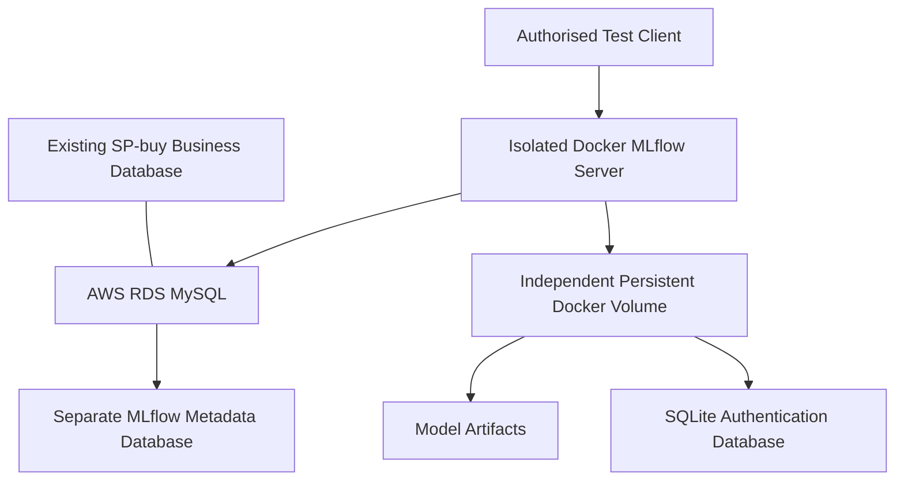

# MLflow Architecture Evaluation and Decision

## 1. Purpose

This document records the architecture evaluation and technology
selection completed under Issue #56 (PBI 06 — More Robust MLflow
System Architecture).

The objective is to identify practical infrastructure improvements
that increase metadata persistence, reliability and maintainability
while remaining feasible within AWS Academy Learner Lab restrictions
and the CA1 submission timeline.

The evaluation builds upon:

- #54 — Initial MLflow architecture review.
- #55 — Web-based GenAI architecture discussion.
- Existing MLflow deployment and verification results.
- Preliminary AWS RDS and Amazon S3 feasibility checks.

This document describes the architecture decision before
implementation. It does not claim that the proposed infrastructure
improvements have already been implemented.

## 2. Existing Architecture

### 2.1 Initial AWS Deployment

The initial MLflow server was deployed using Docker on AWS
Elastic Beanstalk, following Service Deployment Workshop 3.

| Component | Configuration |
|---|---|
| Cloud platform | AWS Elastic Beanstalk |
| Compute infrastructure | Amazon EC2 |
| Python version | 3.12 |
| MLflow version | 3.18.0 |
| Backend store | SQLite |
| Artifact store | Local container filesystem |
| Authentication | Not configured |
| External persistent storage | Not configured |

The initial deployment supported remote experiment tracking,
parameter and metric logging, and artifact upload and retrieval.

However, the architecture introduced risks associated with
container replacement, metadata persistence, artifact availability,
concurrent database writes and access protection.

On 26 November 2026, the Elastic Beanstalk environment became
inaccessible following EC2 instance replacement. Investigation
identified an AWS Academy Service Control Policy (SCP) denial
affecting the s3:ListBucket operation required by the Elastic
Beanstalk application deployment process.

Actual loss of previously stored experiment data was not confirmed.

### 2.2 Current Shared Local Deployment

Following the deployment incident, the team established an
authenticated shared local MLflow server with the lecturer's
approval for demonstration purposes.

| Component | Configuration |
|---|---|
| Deployment | Docker Compose |
| MLflow version | 3.18.0 |
| Backend store | SQLite |
| Artifact store | Persistent Docker named volume |
| Authentication | MLflow Basic Authentication |
| Authentication database | SQLite |
| Remote access | Tailscale private HTTPS |
| Host binding | 127.0.0.1:5006 |
| Container port | 5000 |
| Restart policy | unless-stopped |
| Persistent volume | spbuy-mlflow-shared-data |

The current deployment already provides several improvements
over the initial AWS configuration:

- Persistent metadata and artifact storage.
- Individual authenticated user accounts.
- Restricted private remote access.
- Explicit allowed-host and CORS configuration.
- Container restart and recreation support.
- Externalised authentication and server security settings.

The existing shared server has been verified for experiment
tracking, artifact retrieval, model registration, champion
management and automated experiment logging.

Detailed documentation:

- [Shared Local MLflow Deployment](../mlflow_server/local_deploy/README.md)
- [MLflow Setup and Model Version Management](mlflow_setup.md)

These improvements were established before the architecture
implementation proposed in this document.

### 2.3 Remaining Limitations

Despite the existing improvements:

- SQLite remains the tracking metadata backend.
- Concurrent metadata writes may cause database contention.
- Metadata and artifacts depend on storage on the host machine.
- The host computer must remain online for remote access.
- Persistent volumes do not replace independent backups.
- The local deployment does not provide cloud-level availability.

## 3. GenAI Architecture Discussion

A web-based GenAI discussion was completed under Issue #55
using ChatGPT.

The discussion consisted of four prompting rounds, satisfying
the coursework requirement of fewer than ten prompting rounds.

| Round | Discussion Area |
|---|---|
| 1 | Initial architecture assessment and limitations |
| 2 | Alternative metadata and artifact storage technologies |
| 3 | AWS Academy constraints and architecture feasibility |
| 4 | Conditional architecture selection and implementation plan |

The discussion considered:

- AWS RDS MySQL for experiment metadata.
- Amazon S3 for model artifact storage.
- Persistent Docker volumes.
- Amazon EBS and Amazon EFS.
- Hybrid local and AWS deployment architectures.
- Externalised configuration and credential protection.
- Preservation of existing experiments and registered models.

The recommended approach was to investigate incremental
infrastructure improvements without disrupting the existing
working MLflow environment.

### Shareable GenAI Conversation

https://chatgpt.com/share/6b09996a-0fbc-83ec-ba74-798a361d12a9

## 4. AWS RDS MySQL Feasibility Verification

### 4.1 Verification Approach

The team evaluated whether the existing AWS RDS MySQL instance
could support a separate MLflow metadata database.

The initial verification was performed from the local Python
environment using PyMySQL and the official AWS RDS CA certificate.

Only connectivity checks and read-only SQL operations were
performed during this evaluation.

No existing business tables, database users or records were
modified.

### 4.2 Verification Results

| Verification | Result |
|---|---|
| PyMySQL installation | PASS |
| Required environment configuration | PASS |
| RDS TCP connectivity | PASS |
| MySQL authentication | PASS |
| MySQL server version | 8.4.11 |
| Existing business database | spbuy |
| TLS certificate and identity verification | PASS |
| TLS connection | PASS |
| TLS version | TLSv1.3 |
| CREATE privilege | Available |
| CREATE USER privilege | Available |
| GRANT OPTION | Available |
| Read-only privilege inspection | PASS |

The existing database administrator account has the relevant
privileges required to provision a separate database and
dedicated database account.

These privileges were inspected but were not exercised during
the evaluation.

### 4.3 Feasibility Conclusion

The verification results indicate that the existing AWS RDS
instance is a feasible candidate for an MLflow metadata backend.

The proposed implementation will:

- Reuse the existing RDS instance.
- Create a separate database for MLflow metadata.
- Create a dedicated database account for MLflow.
- Restrict the account's privileges to the MLflow database.
- Maintain TLS-protected database connectivity.
- Preserve the existing spbuy business database.

The following items remain unverified:

- Actual database and user creation.
- Connectivity from inside the Docker container.
- MLflow database schema initialisation.
- Experiment and model registry operations using RDS.
- Resource contention between MLflow and existing ETL workloads.
- Metadata persistence after container recreation.

These activities will be addressed during implementation and
subsequent reliability testing.

## 5. Amazon S3 Feasibility Verification

### 5.1 Service Availability

Amazon S3 was inspected through the AWS Management Console
using the AWS Academy Learner Lab environment.

One existing general-purpose bucket was observed in the
us-east-1 region.

The bucket is associated with Elastic Beanstalk deployment
resources.

The bucket's Objects page was accessible through the current
console session, and existing files and folders could be listed.

### 5.2 Permission Verification

| Verification | Result |
|---|---|
| Amazon S3 console access | PASS |
| General-purpose bucket listing | PASS |
| Object listing using current console identity | PASS |
| Dedicated bucket creation | Not tested |
| Object upload | Not tested |
| Object download | Not tested |
| Access from local Docker MLflow server | Not tested |
| Automatic credential refresh | Not verified |

Successful console access does not guarantee that a local
Docker container or Elastic Beanstalk service role possesses
the same permissions.

The earlier Elastic Beanstalk SCP denial also demonstrates
that S3 permissions may differ across AWS identities and
service execution contexts.

### 5.3 Credential Lifecycle

The AWS Academy Learner Lab provides temporary AWS credentials
containing:

- AWS Access Key ID.
- AWS Secret Access Key.
- AWS Session Token.

The observed Learner Lab session duration was four hours.
However, the exact expiration time of the temporary credentials
was not independently verified.

A local Dockerised MLflow server using manually supplied
temporary credentials would require valid credentials whenever
it accesses Amazon S3.

Without a verified credential refresh mechanism, expired
credentials could interrupt:

- Model artifact uploads.
- Artifact retrieval.
- Model loading.
- Automated experiment logging involving artifacts.

This introduces additional maintenance requirements and
operational risks during the coursework demonstration.

### 5.4 Feasibility Conclusion

Amazon S3 is available through the current AWS console session.

However, the permissions required for MLflow artifact storage
and a reliable credential refresh mechanism have not been
fully verified.

Therefore, S3 integration is deferred rather than classified
as unsupported.

No new S3 buckets were created, no objects were uploaded or
deleted, and no bucket permissions were modified during this
evaluation.

## 6. Architecture Alternatives

### Option A — Elastic Beanstalk + RDS + S3

This architecture separates the application, metadata database
and artifact storage using AWS services.

Advantages:

- Cloud-hosted application.
- External metadata and artifact storage.
- Reduced dependency on an individual team member's laptop.

Limitations:

- Previously observed Elastic Beanstalk SCP restriction.
- Additional deployment and permission requirements.
- Higher implementation and troubleshooting complexity.
- S3 access from the deployment identity remains unverified.

Decision: Not selected for the current implementation.

### Option B — Local Docker + RDS + S3

This hybrid architecture retains local application hosting
while moving metadata and artifacts to AWS storage services.

Advantages:

- External metadata storage.
- Cloud-based artifact storage.
- Avoids the existing Elastic Beanstalk deployment blocker.

Limitations:

- S3 read and write permissions remain unverified.
- Temporary AWS credential management is required under the
  currently available credential arrangement.
- Additional operational complexity.
- The host computer must remain online.

Decision: Deferred.

### Option C — Local Docker + RDS + Persistent Volume

This hybrid architecture uses AWS RDS MySQL for tracking
metadata while retaining persistent local artifact storage.

Advantages:

- Reuses the existing AWS RDS instance.
- Separates tracking metadata from application containers.
- Provides a server-based relational database backend.
- Avoids introducing S3 credential dependencies.
- Retains the existing persistent artifact storage approach.
- Supports isolated implementation and testing.

Limitations:

- Model artifacts remain dependent on local storage.
- The local host must remain online.
- RDS availability and network connectivity remain necessary.
- Shared RDS resource utilisation must be considered.
- End-to-end integration remains unverified.

Decision: Selected for isolated implementation and testing.

### Option D — Local Docker + SQLite + Persistent Volume

This is the existing authenticated shared MLflow architecture.

Advantages:

- Already implemented and verified.
- Low implementation complexity.
- No direct dependency on AWS credentials for MLflow storage.
- Preserves existing experiments and registered models.

Limitations:

- SQLite concurrency limitations.
- Local host and storage dependency.
- Limited infrastructure availability and recovery options.

Decision: Retained as the official working environment and
fallback architecture.

## 7. Architecture Comparison

| Criterion | Option A | Option B | Option C | Option D |
|---|---|---|---|---|
| Application hosting | AWS | Local | Local | Local |
| Metadata storage | RDS | RDS | RDS | SQLite |
| Artifact storage | S3 | S3 | Docker volume | Docker volume |
| External metadata persistence | Yes | Yes | Yes | No |
| Concurrent metadata access potential | Higher | Higher | Higher | Limited |
| Implementation complexity | High | Medium-High | Medium | Low |
| Current feasibility | Deployment blocker | Partially verified | Promising | Verified |
| Decision | Not selected | Deferred | Selected for testing | Retained |

The comparison represents expected architectural properties
and preliminary feasibility findings, rather than measured
availability or performance benchmarks.

## 8. Selected Architecture

### 8.1 Preferred Architecture

Option C is selected as the preferred candidate for the next
implementation stage.

The proposed architecture consists of:

- An isolated Dockerised MLflow 3.18.0 server.
- A separate MLflow metadata database on the existing AWS
  RDS MySQL instance.
- A dedicated database account with database-level privileges.
- TLS-protected database connectivity.
- An independent persistent Docker volume for model artifacts.
- An isolated authentication database.
- Externalised connection and security configuration.

The proposed MLflow metadata database will remain logically
separate from the existing SP-buy business database.

### 8.2 Fallback Architecture

The existing authenticated shared local MLflow server will
remain the official working environment throughout the
implementation and testing process.

No migration or modification of the existing tracking
database, artifact volume, official registered models or
champion aliases is included in the selected implementation
scope.

If the RDS-backed test deployment encounters permission,
compatibility, performance or reliability issues, the team
can continue using the verified existing architecture.

### 8.3 Decision Justification

Option C provides a proportionate infrastructure improvement
for a four-person coursework project.

It addresses the metadata persistence limitation of SQLite
while avoiding the additional deployment and credential
management risks associated with Elastic Beanstalk and S3.

Reusing the existing RDS instance avoids provisioning
another database instance.

The isolated implementation approach protects existing
experiments, trained models, business data and ongoing team
activities.

## 9. Implementation Scope

### Issue #57 — Infrastructure Implementation

- Create a separate MLflow metadata database.
- Create a dedicated database account.
- Configure the required database-level privileges.
- Prepare an isolated MLflow Docker deployment.
- Configure TLS-protected RDS connectivity.
- Configure independent persistent artifact storage.
- Verify initial experiment logging and retrieval.

### Issue #58 — Configuration Management

- Inspect existing hard-coded resource configurations.
- Externalise MLflow and database connection settings.
- Provide safe configuration templates.
- Protect credentials and sensitive configuration files.
- Verify connectivity using external configuration.

### Issue #59 — Reliability Testing and Documentation

- Log test parameters, metrics and model artifacts.
- Verify experiment and artifact retrieval.
- Verify model registration and model loading.
- Test metadata and artifact persistence after container
  recreation.
- Confirm that existing official MLflow records remain intact.
- Verify authorised team access where applicable.
- Document results, architecture changes and limitations.

## 10. Risks and Mitigation

| Risk | Mitigation |
|---|---|
| Disruption to official experiments | Use an independent test deployment |
| Business database modification | Use a separate MLflow database |
| Excessive database privileges | Use a dedicated scoped account |
| Credential exposure | Use private environment configuration |
| Database connection interception | Enable TLS certificate and identity verification |
| Artifact loss during container recreation | Use an independent persistent volume |
| RDS network or availability issues | Retain the existing working MLflow server |
| Increased RDS resource utilisation | Monitor database behaviour during testing |
| Temporary S3 credential expiration | Defer S3 integration |
| Existing Elastic Beanstalk restriction | Avoid unnecessary redeployment attempts |

The proposed architecture improves selected aspects of
metadata persistence but does not constitute a highly
available production deployment.

## 11. Acceptance Criteria Verification

| Issue #56 Acceptance Criterion | Supporting Evidence | Status |
|---|---|---|
| Review GenAI architecture options | Section 3 and Issue #55 | Completed |
| Verify availability of required AWS services | RDS and S3 feasibility checks | Completed |
| Compare reliability, persistence, complexity and feasibility | Sections 6 and 7 | Completed |
| Select suitable architecture improvements | Section 8 | Completed |
| Document the selected architecture and justification | This document | Completed |

The feasibility assessment is preliminary and does not
replace implementation or end-to-end reliability testing.

## 12. Supporting Evidence

- Initial architecture review under Issue #54.
- Four-round GenAI discussion under Issue #55.
- RDS network connectivity verification.
- MySQL authentication and TLS verification.
- Read-only database privilege inspection.
- Amazon S3 bucket listing.
- Amazon S3 object listing.
- AWS Academy temporary credential availability.
- Existing Docker deployment configuration.
- Current shared MLflow setup documentation.

Relevant screenshots and verification outputs are retained
as supporting evidence for Issue #56.

Sensitive credentials and account-specific information must
be excluded or redacted from shared documentation.

## 13. Conclusion

The architecture evaluation identifies a hybrid Local Docker,
AWS RDS MySQL and persistent Docker volume architecture as
the preferred candidate for isolated implementation.

Amazon S3 integration is deferred due to unverified
operational permissions and credential lifecycle concerns.

The existing authenticated local MLflow deployment remains
the official working environment and fallback solution.

The proposed architecture will be implemented under Issue #57,
with configuration improvements under Issue #58 and reliability
verification under Issue #59.

Related issues: #20, #54, #55, #56, #57, #58 and #59.
