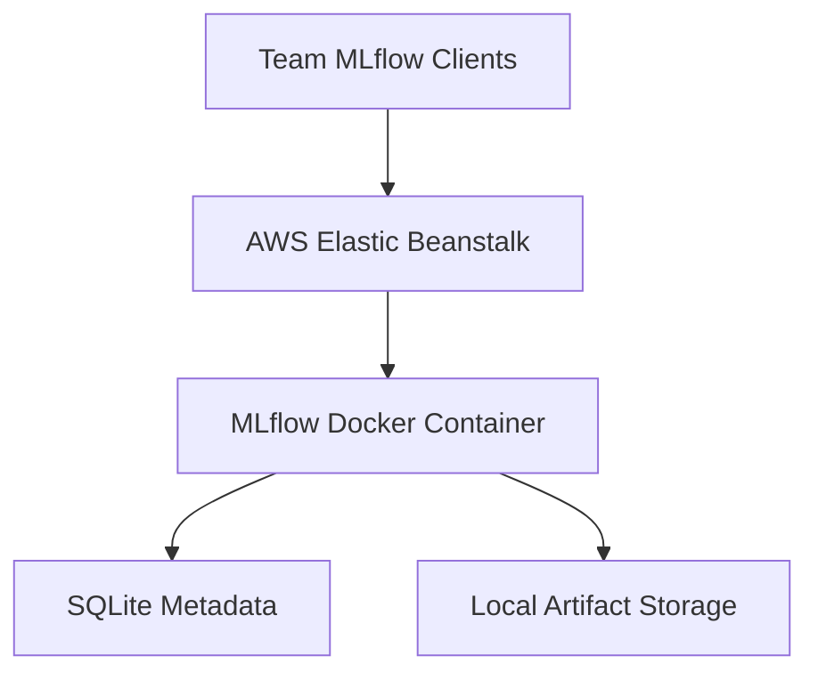
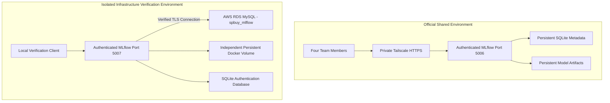

# MLflow Architecture Improvements and Reliability Verification

## 1. Executive Summary

### Project Information

| Item | Details |
|---|---|
| Project | SP-buy Fraud Detection |
| Module | ST1519 Agile MLOps |
| Product Backlog Item | PBI 06 - More Robust MLflow System Architecture (#20) |
| Related Task | #59 - Test Improved MLflow Reliability and Document Architecture Changes |
| Team | Group 5 |
| Reliability test date | 28 November 2026 |

### Implementation Summary

The objective of PBI 06 was to improve the reliability, security, persistence and maintainability of the MLflow infrastructure supporting the SP-buy fraud detection project.

Following architecture evaluation and practical AWS infrastructure testing, the team selected an incremental improvement strategy rather than a complete migration.

The existing authenticated shared MLflow server was retained as the official team environment. A separate RDS-backed MLflow deployment was implemented to evaluate an improved metadata storage architecture without disrupting existing experiments, model registry records or team workflows.

The isolated deployment successfully passed functional verification, container restart testing and container recreation testing.

Experiment metadata, the tested model artifact and authentication enforcement were preserved throughout the reliability tests.

The official shared MLflow environment remained operational, with its original container identity, registered model versions and champion alias preserved.

Four-person accessibility confirmation is being completed separately.

---

## 2. Initial Architecture and Identified Risks

### 2.1 Initial AWS Elastic Beanstalk Deployment

The initial cloud deployment used AWS Elastic Beanstalk to host a Docker-based MLflow server.

The initial deployment relied on SQLite for experiment metadata and local container storage for model artifacts.



Although the initial deployment was successfully demonstrated, subsequent deployment attempts encountered AWS Academy permission restrictions.

A replacement deployment failed because the environment could not perform the required S3 ListBucket operation for deployment resources.

The identified failure involved deployment infrastructure permissions rather than the fraud detection model training logic.

### 2.2 Identified Architecture Risks

| Risk | Potential Impact |
|---|---|
| AWS Academy permission restrictions | Deployment and environment replacement may fail |
| Container-local metadata storage | Experiment metadata may be lost when storage is not preserved |
| Container-local artifact storage | Model artifacts may become unavailable after replacement |
| Limited initial access controls | Unauthorised access to tracking resources |
| Hard-coded resource configurations | Reduced portability and maintainability |
| Temporary AWS Academy credentials | Reduced suitability for unattended cloud operations |
| Dependence on managed deployment permissions | Limited ability to resolve infrastructure failures independently |

Potential storage loss was identified as an architecture risk. Actual historical data loss was not independently established.

### 2.3 Official Local Fallback

Following deployment difficulties, an authenticated local Docker-based MLflow server was established as the official shared team environment.

The server provides:

- Individual MLflow user accounts.
- Basic authentication.
- Private HTTPS access through Tailscale.
- Persistent SQLite metadata storage.
- Persistent model artifact storage.
- Shared experiment tracking.
- Model registry and champion alias management.

The existing official environment was retained throughout PBI 06 to minimise disruption to the team.

---

## 3. GenAI-assisted Architecture Evaluation

### 3.1 GenAI Conversation

The architecture improvement strategy was evaluated through four rounds of web-based GenAI discussion.

Conversation link:

https://chatgpt.com/share/6b09996a-0fbc-83ec-ba74-798a361d12a9

Related tasks:

- #54 - Review Initial MLflow Architecture.
- #55 - Conduct GenAI Architecture Discussion.
- #56 - Evaluate and Select Feasible Architecture Improvements.

The discussion considered cloud deployment alternatives, database backend options, artifact storage, access control, AWS Academy constraints and practical implementation risks.

### 3.2 Human Evaluation and Final Decision

GenAI suggestions were evaluated against:

- Actual AWS Academy permissions.
- Existing infrastructure availability.
- Security implications.
- Team accessibility requirements.
- Coursework scope.
- Implementation complexity.
- Submission timeline.
- Risk of disrupting existing experiments and registered models.

The team did not adopt all suggested infrastructure improvements.

AWS RDS MySQL was selected for isolated metadata backend verification because the existing RDS instance was available and the required database permissions could be established.

S3 artifact storage was evaluated but deferred because dedicated bucket permissions, end-to-end artifact operations and temporary credential renewal had not been sufficiently verified.

The selected approach prioritised feasible, testable improvements rather than introducing unnecessary infrastructure complexity.

Detailed evaluation:

[Architecture Evaluation and Selection](mlflow_architecture_evaluation.md)

---

## 4. Final Implemented Architecture

### 4.1 Architecture Overview

The final implementation consists of two independent MLflow deployments with separate responsibilities.



The isolated RDS-backed deployment does not replace the official shared environment.

### 4.2 Official Shared MLflow

| Component | Implementation |
|---|---|
| Deployment | Local Docker |
| Container | spbuy-mlflow-shared |
| MLflow version | 3.18.0 |
| Host port | 5006 |
| Metadata backend | SQLite |
| Artifact storage | Persistent Docker volume |
| Authentication | MLflow basic authentication |
| Team access | Private Tailscale HTTPS |
| Persistent volume | spbuy-mlflow-shared-data |
| Restart policy | unless-stopped |
| Purpose | Official team experiment tracking and model registry |

### 4.3 Isolated RDS-backed MLflow

| Component | Implementation |
|---|---|
| Deployment | Local Docker Compose |
| Container | spbuy-mlflow-rds-test |
| MLflow version | 3.18.0 |
| Host binding | 127.0.0.1:5007 |
| Metadata backend | AWS RDS MySQL |
| Database engine version | MySQL 8.4.11 |
| Metadata database | spbuy_mlflow |
| Database account | Dedicated schema-scoped account |
| Database transport | TLS |
| Artifact storage | Persistent Docker volume |
| Authentication database | Persistent local SQLite |
| Persistent volume | spbuy-mlflow-rds-test-data |
| Volume destination | /app/data |
| Purpose | Isolated infrastructure improvement verification |

The two environments use different containers, ports, persistent volumes and metadata backends.

No official experiment records or registered models were migrated into the isolated environment.

---

## 5. Implemented Infrastructure Improvements

### 5.1 AWS RDS Metadata Backend

The existing AWS RDS MySQL instance was reused to support the isolated MLflow deployment.

The implementation introduced:

- A separate metadata database named spbuy_mlflow.
- A dedicated database account restricted to the MLflow schema.
- TLS-required database authentication.
- Certificate and hostname verification for the isolated deployment connection.
- Separation from the existing spbuy business database.
- SQLAlchemy and PyMySQL connectivity.

The dedicated metadata database account was verified to have access to the MLflow schema and was denied access to the business database.

Direct database verification in #57 confirmed that MLflow experiment and run metadata were stored in the RDS-backed schema.

### 5.2 AWS Parameter Group Adjustment

The initial RDS-backed deployment encountered a MySQL migration restriction when MLflow attempted to create a required database trigger.

The relevant MySQL error was 1419.

The RDS instance owner implemented a custom MySQL 8.4 parameter group and enabled:

```text
log_bin_trust_function_creators = 1
```

This permitted the required MLflow schema migration without granting global administrative privileges to the dedicated MLflow database account.

The initial incomplete test schema was safely reset after confirming that it did not contain experiment records.

The subsequent schema migration completed successfully.

| Verification | Result |
|---|---|
| MLflow database schema initialisation | PASS |
| Database tables | 71 |
| Required database trigger | Present |
| Dedicated database authentication | PASS |
| TLS verification | PASS |
| Functional MLflow API access | PASS |

The parameter group adjustment applies at the RDS instance level and relaxes a MySQL restriction related to stored functions and triggers.

This represents a security and operational trade-off that should be reviewed before applying the same configuration in a production environment.

Binary logging remained enabled.

The RDS owner reported that existing business data remained available following the parameter group adjustment and instance reboot. An exhaustive before-and-after reconciliation of all business records was not performed.

No further RDS reboot or schema reset was performed during #59.

### 5.3 Persistent Artifact Storage

S3 artifact storage was not implemented.

Instead, the isolated deployment uses an independent named Docker volume:

```text
spbuy-mlflow-rds-test-data
```

The volume is mounted at:

```text
/app/data
```

MLflow model artifacts are stored under:

```text
/app/data/mlartifacts
```

This separates artifact persistence from the application container lifecycle.

The authentication database is also stored in the persistent volume.

The volume remains dependent on the local Docker host. It is not equivalent to replicated cloud object storage or a disaster recovery backup.

### 5.4 Authentication and Network Isolation

The isolated deployment retains MLflow basic authentication and is bound to localhost.

Its authentication configuration and RDS CA certificate are mounted as read-only files.

The official shared deployment continues to provide authenticated private HTTPS access to team members through Tailscale.

The isolated deployment is not exposed as a replacement shared team server.

### 5.5 Externalised Resource Configurations

Task #58 standardised resource connection configuration through environment variables and safe configuration templates.

The implementation included:

- A project-level .env.example template.
- External MLflow tracking URI configuration.
- External database connection configuration.
- Removal of outdated hard-coded notebook tracking endpoints.
- Replacement of an actual RDS endpoint in a database module docstring.
- Preservation of existing functional database connection logic.
- Read-only connection verification.
- Targeted repository credential screening.

Actual runtime credentials and sensitive configuration files are excluded from version control.

The project-level template documents required environment variables but is not automatically loaded by the application.

Detailed configuration guide:

[Resource Configuration Guide](resource_configuration.md)

---

## 6. Reliability Testing Methodology

### 6.1 Test Objectives

The reliability tests were designed to verify whether the isolated RDS-backed MLflow deployment could recover from application container lifecycle operations without losing previously recorded metadata or the selected model artifact.

The following stages were performed:

1. Pre-restart baseline verification.
2. Container restart.
3. Post-restart application and data verification.
4. Container recreation.
5. Post-recreation application and data verification.
6. Official shared MLflow safety verification.
7. Team accessibility confirmation.

### 6.2 Controlled Test Scope

Only the isolated MLflow application container was restarted and recreated.

The following resources were preserved:

- Existing AWS RDS metadata database.
- Existing Docker image.
- Existing persistent artifact volume.
- Existing authentication configuration.
- Existing RDS CA certificate.
- Official shared MLflow container.
- Existing business database.

No new model training was required during #59.

Existing test data from #57 was reused.

No experiment records were intentionally modified by the reliability verification procedures.

### 6.3 Test Experiment

| Item | Value |
|---|---|
| Experiment | SP-buy-RDS-Infrastructure-Test |
| Experiment ID | 1 |
| Run name | rds-functional-smoke-test |
| Run ID | a2641059e281470ab7492fc1767ca508 |
| Run status | FINISHED |
| Model type | DecisionTree |
| Max depth | 2 |
| Test metric | 0.95 |
| Purpose tag | infrastructure_verification |
| Model artifact | model/test_model.joblib |
| Artifact size | 1513 bytes |

The test metric of 0.95 is synthetic infrastructure verification data. It is not a fraud detection model evaluation result.

### 6.4 Artifact Integrity Verification

The original model artifact SHA-256 checksum from #57 was used as the reference:

```text
2b96afa48041977506acc89eea7ff6f41b3e71ade04ababba478eaf706a735b3
```

The artifact was downloaded through the MLflow API at each reliability testing stage.

Its size and SHA-256 checksum were compared against the original reference.

An identical SHA-256 checksum provides evidence that the tested artifact content remained unchanged.

### 6.5 Existing Training Workflow Verification

A representative project training workflow had previously been executed against the isolated RDS-backed deployment in #57.

| Item | Value |
|---|---|
| Experiment | SP-buy-RDS-Workflow-Compatibility-Test |
| Experiment ID | 2 |
| Run ID | 51b510e2710c4bbfb16dd1706f53462c |
| Run name | abby_logistic_regression_safe_v1 |
| Run status | FINISHED |

The experiment and run metadata were retrieved during each reliability testing stage.

The native MLflow model artifact associated with this representative training workflow was not independently reloaded during #59.

Artifact checksum testing focused on the synthetic DecisionTree model artifact.

---

## 7. Reliability Test Results

### 7.1 Pre-restart Baseline

The initial verification confirmed that the original test records and model artifact from #57 remained available before performing container lifecycle operations.

| Verification | Result |
|---|---|
| Experiment retrieval | PASS |
| Run retrieval | PASS |
| Parameter verification | PASS |
| Metric verification | PASS |
| Tag verification | PASS |
| Artifact listing | PASS |
| Artifact download | PASS |
| Original artifact checksum | PASS |
| Existing training workflow retrieval | PASS |
| Overall baseline verification | PASS |

The baseline also confirmed that the official and isolated deployments used independent persistent volumes.

Evidence:

- 59_01_pre_restart_baseline_verification.png

### 7.2 Container Restart Test

The isolated container was restarted using:

```powershell
docker restart spbuy-mlflow-rds-test
```

The same application container was restarted without deleting the persistent volume.

| Verification | Result |
|---|---|
| Container identity retained | PASS |
| Container startup time updated | PASS |
| Persistent volume retained | PASS |
| Authenticated API response | HTTP 200 |
| Application recovery | PASS |
| Experiment metadata persistence | PASS |
| Parameter, metric and tag integrity | PASS |
| Model artifact retrieval | PASS |
| Artifact checksum integrity | PASS |
| Existing training workflow persistence | PASS |
| Unauthenticated API response | HTTP 401 |
| Authentication enforcement | PASS |
| Overall restart reliability | PASS |

The application readiness check elapsed time was 17.18 seconds.

This measures the duration of the readiness verification after it was initiated. It is not an end-to-end service recovery time measured from the start of the restart operation.

Evidence:

- 59_02_post_restart_reliability_verification.png

### 7.3 Container Recreation Test

A new isolated MLflow container was created using the existing Docker image and persistent volume.

```powershell
docker compose -f mlflow_server/rds_deploy/docker-compose.yml --env-file mlflow_server/rds_deploy/.env up -d --no-build --pull never --force-recreate mlflow
```

The configuration was validated before recreation.

All four required deployment configuration files were available.

The existing Docker image and named persistent volume were confirmed before proceeding.

Docker Compose reported that the recreation and container startup operation completed in 6.4 seconds.

This duration does not represent complete application readiness or end-to-end recovery time.

| Verification | Result |
|---|---|
| New application container created | PASS |
| Original Docker image retained | PASS |
| Original persistent volume retained | PASS |
| Application recovery | PASS |
| RDS experiment metadata persistence | PASS |
| Parameter, metric and tag integrity | PASS |
| Model artifact retrieval | PASS |
| Original artifact checksum | PASS |
| Post-restart artifact checksum | PASS |
| Existing training workflow persistence | PASS |
| Unauthenticated API response | HTTP 401 |
| Authentication enforcement | PASS |
| Overall recreation reliability | PASS |

Evidence:

- 59_03_post_recreation_reliability_verification.png

### 7.4 Container Lifecycle Comparison

All container startup timestamps below are recorded in UTC.

| Stage | Container ID | Started at |
|---|---|---|
| Baseline | c26f3d6bf485 | 2026-11-28 02:53:05 |
| Restart | c26f3d6bf485 | 2026-11-28 11:19:54 |
| Recreation | 6127453fc21b | 2026-11-28 14:36:00 |

The unchanged container ID after restart confirms that the original container was restarted.

The different container ID after recreation confirms that the original application container was replaced.

The same Docker image and persistent volume were retained during recreation.

### 7.5 Consolidated Reliability Results

| Verification | Baseline | After Restart | After Recreation |
|---|---|---|---|
| Application access | PASS | PASS | PASS |
| Experiment ID | 1 | 1 | 1 |
| Original run ID | Retained | Retained | Retained |
| Run status | FINISHED | FINISHED | FINISHED |
| Parameters | PASS | PASS | PASS |
| Metrics | PASS | PASS | PASS |
| Tags | PASS | PASS | PASS |
| Artifact listing | PASS | PASS | PASS |
| Artifact download | PASS | PASS | PASS |
| Artifact size | 1513 bytes | 1513 bytes | 1513 bytes |
| SHA-256 comparison | PASS | PASS | PASS |
| Workflow metadata | PASS | PASS | PASS |
| Authentication enforcement | Verified in #57 | PASS | PASS |
| Persistent volume | Retained | Retained | Retained |
| Overall result | PASS | PASS | PASS |

All planned isolated application container lifecycle tests passed.

### 7.6 Reliability Assessment

The results demonstrate that the tested experiment metadata and model artifact do not depend on the original MLflow application container.

The AWS RDS metadata backend preserved the tested experiment and run records.

The persistent Docker volume preserved the tested model artifact across restart and recreation.

Authentication remained enforced after both container lifecycle operations.

The results support the selected architecture for controlled infrastructure verification within the coursework environment.

They do not establish production-level availability, complete disaster recovery capability or persistence of every possible historical record.

---

## 8. Official Server Safety and Team Accessibility

### 8.1 Official Server Preservation

After completing the isolated deployment reliability tests, the official shared MLflow server was verified independently.

| Verification | Result |
|---|---|
| Authenticated MLflow access | PASS |
| Official experiment | SP-buy-Fraud-Detection |
| Experiment ID | 2 |
| Current active runs | 42 |
| Registered model version 1 | READY |
| Registered model version 2 | READY |
| Original model run IDs | Unchanged |
| Champion alias | Version 1 |
| Isolated test experiments | Not present |
| Official container ID | ecd45a80227c |
| Official container status | Running |
| Official startup timestamp | Unchanged |
| Overall official server safety | PASS |

The original official container startup timestamp was:

```text
2026-11-27T07:37:31.381154029Z
```

The unchanged container identity and startup timestamp demonstrate that the official application container was not restarted or replaced during the isolated reliability tests.

### 8.2 Model Registry Preservation

Registered model:

```text
SP-buy-Fraud-Detector
```

| Version | Original Run ID | Status |
|---|---|---|
| 1 | 2ad5cf74f0f040d9841767e94331af10 | READY |
| 2 | f6d5330039164615bdd37dea09df56d0 | READY |

The champion alias continued to reference Version 1.

Both original registered model versions remained retrievable.

Registry retrieval does not independently establish that every registered model artifact can be loaded successfully.

### 8.3 Experiment Isolation

The following isolated infrastructure test experiments were confirmed to be absent from the official shared server:

- SP-buy-RDS-Infrastructure-Test.
- SP-buy-RDS-Workflow-Compatibility-Test.

This supports the intended separation between the official tracking environment and the isolated architecture verification environment.

### 8.4 Continued Team Usage

The official experiment contained 32 active runs during the #57 verification.

During the final #59 safety verification, the official experiment contained 42 active runs.

This increase is consistent with continued project usage.

The run count alone does not establish the identity of every contributor or independently verify accessibility for all four team members.

Evidence:

- 59_04_official_mlflow_safety_verification.png

### 8.5 Individual Team Accessibility

Team members were requested to verify that they could access the official shared MLflow server and view the existing fraud detection experiment and runs.

No additional model training or new experiment logging was required.

| Team Member | Verification Method | Status |
|---|---|---|
| Abby | Local authenticated MLflow API | PASS |
| Maria | Private Tailscale access and individual account | Pending confirmation |
| Emi | Private Tailscale access and individual account | Pending confirmation |
| Chu | Private Tailscale access and individual account | Pending confirmation |

Current independently recorded accessibility confirmations: 1 of 4.

The four-person accessibility acceptance criterion remains pending until the remaining confirmations are obtained.

Evidence:

- 59_05_team_accessibility_confirmation.png - Pending.

---

## 9. Initial and Improved Architecture Comparison

| Aspect | Initial EB Deployment | Official Shared Deployment | Isolated Improved Deployment |
|---|---|---|---|
| Application hosting | AWS Elastic Beanstalk | Local Docker | Local Docker Compose |
| Metadata backend | SQLite | Persistent SQLite | AWS RDS MySQL |
| Artifact storage | Container-local | Named Docker volume | Independent named Docker volume |
| Authentication | Initial deployment without basic authentication | Basic authentication | Basic authentication |
| Team connectivity | EB endpoint | Private Tailscale HTTPS | Localhost only |
| Configuration | Initial deployment settings | External runtime configuration | External runtime configuration |
| Metadata separation | Application-local | Official local database | Dedicated RDS schema |
| Database transport | Not applicable | Not applicable | Verified TLS in #57 |
| Application restart persistence | Not established | Not tested in #59 | Verified |
| Application recreation persistence | Not established | Not tested in #59 | Verified |
| Operational role | Initial cloud deployment | Official team environment | Infrastructure verification |

### 9.1 Achieved Improvements

The completed implementation provides:

- External relational metadata storage in the isolated deployment.
- Dedicated database access with schema-level separation.
- Verified TLS database connectivity.
- Persistent artifact storage independent of the application container.
- Preserved authentication configuration.
- Externalised resource connection settings.
- Successful container restart and recreation verification.
- Preservation of the official team environment.
- Documented configuration and infrastructure verification procedures.

### 9.2 Operational Trade-offs

The selected architecture avoids a full migration and preserves the existing team environment.

However, operating separate deployments introduces additional configuration and maintenance requirements.

The isolated deployment requires connectivity to the AWS RDS instance.

Its artifact and authentication storage remain dependent on the local Docker host.

The official shared deployment also depends on the availability of the host computer and private network connection.

The RDS-backed implementation improves metadata separation and tested application lifecycle persistence but does not establish a fully cloud-hosted or highly available MLflow service.

### 9.3 Remaining Limitations

The following items were not implemented or independently verified:

- Complete migration of official experiments and registered models to RDS.
- S3 artifact storage.
- Dedicated S3 bucket permissions and end-to-end artifact operations.
- Automated AWS Academy credential renewal.
- RDS failover and database disaster recovery.
- Docker host failure and volume loss recovery.
- Automated backup and restore procedures.
- Production-level high availability.
- Load testing and concurrent user capacity benchmarking.
- End-to-end recovery time measurement.
- Exhaustive validation of every historical MLflow record.
- Native model reload verification for the representative training workflow during #59.
- A complete historical Git credential scan.
- Independent business database certificate and hostname verification in #58.

The RDS parameter group adjustment also requires further security review before production adoption.

These limitations are retained explicitly to avoid overstating the reliability and security demonstrated by the coursework implementation.

### 9.4 Recommended Future Improvements

Subject to appropriate AWS permissions and project requirements, future improvements may include:

1. Dedicated S3 artifact storage with restricted IAM permissions.
2. Automated credential management and renewal.
3. Scheduled database and artifact backups.
4. Documented restoration and disaster recovery testing.
5. Managed application hosting with suitable deployment permissions.
6. Monitoring, health checks and alerting.
7. Concurrent user and performance benchmarking.
8. Controlled migration of official experiment metadata and model artifacts.

These are future recommendations, not completed implementation outcomes.

---

## 10. Acceptance Criteria and Supporting Evidence

### 10.1 Acceptance Criteria Mapping

| AC | Requirement | Supporting Evidence | Status |
|---|---|---|---|
| AC1 | Use a test experiment containing parameters, metrics and a model artifact | #57 functional smoke test and Section 6 | Satisfied |
| AC2 | Retrieve recorded metadata and model artifact | Baseline, restart and recreation results | Satisfied |
| AC3 | Verify restart and container recreation persistence | Sections 7.2 and 7.3 | Satisfied |
| AC4 | Verify official team accessibility and isolated deployment operation | Official safety results and individual accessibility confirmations | Partially verified |
| AC5 | Document initial and improved architectures, outcomes and limitations | Sections 2-5 and 9 | Documented |
| AC6 | Include GenAI link, AWS changes, test results and screenshots | Sections 3, 5, 7, 8 and issue evidence | Satisfied - supporting screenshots uploaded to #59 |

The acceptance criteria should be formally checked in GitHub after reviewing the documentation and completing the remaining evidence collection.

### 10.2 Screenshot Evidence Index

| Screenshot | Evidence |
|---|---|
| 59_01_pre_restart_baseline_verification.png | Original metadata and artifact integrity |
| 59_02_post_restart_reliability_verification.png | Application recovery and data persistence after restart |
| 59_03_post_recreation_reliability_verification.png | Application recovery and data persistence after recreation |
| 59_04_official_mlflow_safety_verification.png | Official environment preservation and registry verification |
| 59_05_team_accessibility_confirmation.png | Pending individual team access confirmations |

The screenshot evidence is maintained through the GitHub issue discussion to avoid committing unnecessary terminal screenshots to the repository.

Final evidence location:

https://github.com/ABBYKETING/MLOps_CA1_group5/issues/59

### 10.3 Related Documentation

- [Initial MLflow Setup](mlflow_setup.md)
- [Architecture Evaluation](mlflow_architecture_evaluation.md)
- [RDS-backed Deployment Implementation](../mlflow_server/rds_deploy/README.md)
- [Official Local Deployment](../mlflow_server/local_deploy/README.md)
- [Resource Configuration Guide](resource_configuration.md)

### 10.4 Related GitHub Issues

| Issue | Purpose |
|---|---|
| #20 | More Robust MLflow System Architecture |
| #54 | Initial architecture review |
| #55 | GenAI architecture discussion |
| #56 | Architecture evaluation and selection |
| #57 | AWS infrastructure improvements |
| #58 | External resource configurations |
| #59 | Reliability verification and final architecture documentation |

### 10.5 Related Implementation Pull Requests

| Pull Request | Scope |
|---|---|
| #122 | Architecture evaluation and selection |
| #123 | Isolated RDS-backed MLflow deployment |
| #124 | Externalised resource configurations |

---

## 11. Final Conclusion

The architecture improvement work established and verified a separate RDS-backed MLflow deployment while retaining the existing authenticated shared MLflow environment.

The selected architecture successfully externalised experiment metadata into AWS RDS and preserved model artifacts through an independent persistent Docker volume.

Both application container restart and container recreation tests passed.

The original test experiment, run records, parameters, metrics, tags and model artifact remained retrievable.

The tested artifact retained the same size and SHA-256 checksum across all verification stages.

Authentication remained enforced following both container lifecycle operations.

The official shared MLflow environment remained operational, with its original container identity, registered models and champion alias preserved.

The results demonstrate practical and measurable improvements to application lifecycle reliability, resource separation and configuration maintainability within the available coursework infrastructure.

The isolated infrastructure reliability testing is complete. The four technical verification screenshots have been uploaded to #59. Final four-person accessibility confirmation remains outstanding.

The official authenticated shared MLflow deployment continues to serve as the team's primary experiment tracking and model registry environment.
