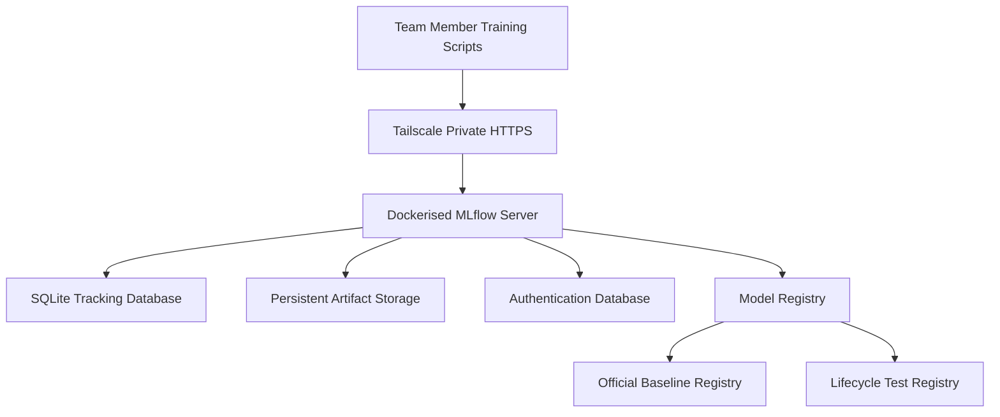

# MLflow Setup and Model Version Management Guide

## 1. Purpose

This guide documents the shared MLflow system used by the SP-buy Fraud Detection project, including deployment, experiment tracking, model registration, champion management and model version lifecycle verification.

It consolidates the work completed under PBI 3, with references to the existing detailed documentation.

## 2. Deployment Architecture



| Component | Implementation |
|---|---|
| MLflow version | 3.18.0 |
| Deployment | Docker Compose |
| Tracking backend | SQLite |
| Artifact storage | Persistent Docker named volume |
| Authentication | MLflow Basic Authentication |
| Remote access | Tailscale private HTTPS |
| Host port | 127.0.0.1:5006 |
| Container port | 5000 |

The initial AWS Elastic Beanstalk deployment encountered an AWS Academy permission restriction during a subsequent deployment.

The lecturer approved using a local MLflow server for the demonstration. Therefore, an authenticated shared local server was established as the demonstration environment.

This does not represent a completed production AWS deployment.

## 3. Server Setup and Authentication

Detailed installation and configuration instructions:

[Shared Local MLflow Server Guide](../mlflow_server/local_deploy/README.md)

For an existing configured deployment:

```powershell
cd mlflow_server/local_deploy
docker compose up -d
docker compose ps
```

Verify private remote access:

```powershell
tailscale serve status
```

Each team member uses an individual MLflow account.

Required client environment variables:

- MLFLOW_TRACKING_URI
- MLFLOW_REGISTRY_URI
- MLFLOW_TRACKING_USERNAME
- MLFLOW_TRACKING_PASSWORD

The tracking and registry URIs should point to the same authorised shared server.

Credentials and actual deployment secrets must be distributed privately and must never be committed to Git.

## 4. Experiment Tracking

Official experiment: `SP-buy-Fraud-Detection`

The project uses shared logging components in:

- `src/mlflow_utils.py`
- `src/model_utils.py`
- `src/training_interface.py`
- `src/retraining_workflow.py`

The tracking system records:

- Model developer and algorithm
- Hyperparameters and decision thresholds
- Validation and test metrics
- Dataset checksums and feature information
- Trained model artifacts
- Evaluation plots
- Run identifiers and model lineage

The baseline experiment originally contained 16 completed model runs.

Additional retraining activities subsequently produced:

| Run category | Count |
|---|---:|
| Original baseline model runs | 16 |
| Successful retraining model runs | 9 |
| Successful retraining pipeline runs | 2 |
| Earlier failed runs | 3 |
| Total active runs observed | 30 |

The nine successful retraining model runs include eight different model tasks and one repeated LightGBM training task.

Run counts represent the observed server state during Issue #41 verification and may increase as further experiments are logged.

Failed runs are retained as part of the experiment history.

Model runs should be identified using immutable run IDs and appropriate metadata rather than relying only on run names or a fixed experiment run count.

## 5. Baseline Model Selection

The original model selection process prioritised precision while maintaining reasonable recall.

The team adopted a proposed minimum validation precision of 70%, with recall maximised among thresholds satisfying that condition.

This numeric target is a technical comparison policy, not a stakeholder-mandated requirement.

Only Safe models were considered for baseline registration. Full models were retained for exploratory comparison.

Detailed methodology:

[Model Comparison and Selection](model_comparison.md)

Locked baseline selection:

[Top Two Models Manifest](top_two_models.json)

## 6. Official Model Registry

Registered model: `SP-buy-Fraud-Detector`

| Version | Algorithm | Alias |
|---|---|---|
| 1 | Extra Trees | champion |
| 2 | Decision Tree | challenger |

The baseline registration and promotion implementation is provided by:

- `src/model_registry.py`
- `src/model_promotion.py`
- `src/model_registry_verification.py`

These scripts were designed around the locked baseline selection.

They should not be treated as unrestricted future model registration or promotion tools.

The baseline inventory checks may require refinement when additional retraining runs are present in the same experiment.

Detailed implementation and verification:

[Baseline Model Registry Documentation](model_registry.md)

Both official baseline models remain CA1 demonstration candidates with `production_eligible=false`.

## 7. Model Version Lifecycle Verification

### 7.1 Objective

Issue #41 validates whether the shared MLflow system supports additional model experiments, new registered versions, consistent model comparison, controlled champion updates and continued access to historical model versions.

Existing retraining results were reused rather than repeating model training.

A separate registered model was used to avoid changing the official baseline champion.

Test registry: `SP-buy-Fraud-Detector-Version-Test`

### 7.2 Source Models

| Attribute | Initial Test Champion | New Candidate |
|---|---|---|
| Algorithm | Decision Tree | Extra Trees |
| Source | Original baseline | Retraining workflow |
| Run ID | f6d5330039164615bdd37dea09df56d0 | 4ee05747a8ec4e3ebc137593e2fcbdf8 |
| Logged model ID | m-8cf5204701264128b8e9eb066157ea78 | m-d677c238f33e4ceaa8933249b81d5b97 |
| Dataset | Safe | Safe |
| Input features | 31 | 31 |

The retrained Extra Trees model originated from a successful retraining pipeline run using the current RDS state.

Parent run ID:

`78d1407153554b66886e86aa0f593178`

Both models had 949,872 records in their respective prepared datasets, but their dataset checksums and chronological training boundaries differed.

There is no verified evidence that additional orders were included in this particular retraining execution.

### 7.3 Common Evaluation Dataset

The original and retrained models used different chronological split boundaries.

| Partition boundary | Baseline | Retrained |
|---|---|---|
| Training end | 2023-03-15 | 2023-03-16 |
| Validation start | 2023-03-16 | 2023-03-17 |
| Validation end | 2023-04-13 | 2023-04-13 |
| Test start | 2023-04-14 | 2023-04-14 |

For a consistent comparison, both models were evaluated on the same records from the verified historical Safe dataset.

- Evaluation period: 2023-03-17 to 2023-04-13
- Orders: 134,532
- Fraud cases: 18,182
- Features: 31
- Minimum precision: 70%

Evaluation dataset SHA-256:

`656a05ca11891816989d51eeaf4c706aab2e9b38682fdf2112baf91f4fc32b93`

This evaluation period was outside both models' training partitions.

The comparison uses a common validation period rather than a new independent test set.

### 7.4 Comparison Method

The following procedure was applied to both models:

1. Load the verified historical Safe feature dataset.
2. Select the common validation period.
3. Load each trained model using its logged model ID.
4. Generate fraud probabilities using predict_proba.
5. Calculate precision and recall across available thresholds.
6. Retain thresholds satisfying the minimum precision of 70%.
7. Select the threshold that maximises recall.
8. Compare the eligible models using recall, precision and PR-AUC.

The original training thresholds were preserved separately from the newly selected lifecycle evaluation thresholds.

### 7.5 Comparison Results

| Metric | Original Decision Tree | Retrained Extra Trees |
|---|---:|---:|
| Precision | 70.1229% | 70.0118% |
| Recall | 15.0643% | 19.5688% |
| F1-score | 0.248008 | 0.305880 |
| PR-AUC | 0.513906 | 0.515451 |
| Flagged orders | 3,906 | 5,082 |
| Selected threshold | 0.5700934579439252 | 0.7737980646665473 |
| Meets minimum precision | Yes | Yes |

The retrained Extra Trees model achieved a recall improvement of 4.5045 percentage points while satisfying the minimum precision requirement.

It was therefore selected as the new champion within the isolated lifecycle test registry.

### 7.6 Model Registration and Champion Update

The existing logged models were registered as two versions of the lifecycle test registered model.

Each registered version preserved:

- Source run ID and logged model ID
- Algorithm and Safe dataset designation
- Training dataset checksum
- Evaluation dataset checksum and date range
- Original and selected decision thresholds
- Validation precision and recall
- Registration scope and eligibility metadata

Before promotion:

| Version | Algorithm | Alias |
|---|---|---|
| 1 | Decision Tree | champion |
| 2 | Extra Trees | None |

The champion alias was updated only after confirming that both models met the minimum precision requirement and the candidate achieved higher recall.

After promotion:

| Version | Algorithm | Alias |
|---|---|---|
| 1 | Decision Tree | None |
| 2 | Extra Trees | champion |

Both versions remained READY.

The official baseline registered model and its aliases remained unchanged.

### 7.7 Registry Management Procedures

Use the MLflow Python client to inspect registered models and versions.

```python
import mlflow

client = mlflow.MlflowClient()

name = "SP-buy-Fraud-Detector-Version-Test"

versions = client.search_model_versions(
    f"name='{name}'"
)

champion = client.get_model_version_by_alias(
    name, "champion"
)
```

New model versions can be created using `mlflow.register_model` with an existing logged model URI.

Before registering, inspect the existing versions and verify the source run, eligibility, dataset information and evaluation metadata.

Champion updates use:

```python
client.set_registered_model_alias(
    name, "champion", "2"
)
```

This write operation must only be performed after verifying the candidate against the defined evaluation policy.

The example targets the lifecycle test registry, not the official baseline registry.

After promotion, resolve the alias again and verify that it points to the expected version.

Do not delete historical versions simply because they are no longer champions.

### 7.8 Model and Artifact Accessibility

Both registered test versions were loaded and evaluated on 64 common validation records per version.

The updated champion was also loaded through its alias and evaluated on the same records.

| Verification | Result |
|---|---|
| Previous champion loading | PASS |
| New champion loading | PASS |
| Version-based predictions | 128 verified |
| Alias-based predictions | 64 verified |
| Probability consistency | PASS |
| Classification consistency | PASS |
| Decision thresholds preserved | PASS |
| Evaluation artifact downloads | 8/8 |
| Official registry integrity | PASS |

Four evaluation artifacts were successfully downloaded from each source experiment run.

These included validation and test confusion matrices and precision-recall curves.

### 7.9 Model Consumption and Recovery

For consistent threshold-based inference, resolve the champion alias to its registered version before loading the model.

```python
version = client.get_model_version_by_alias(
    name, "champion"
)

model = mlflow.sklearn.load_model(
    f"models:/{name}/{version.version}"
)

threshold = float(
    version.tags["decision_threshold"]
)

# X must contain the expected Safe input features.
probabilities = model.predict_proba(X)[:, 1]
predictions = (probabilities >= threshold).astype(int)
```

The registered decision threshold must be used instead of assuming the default classifier threshold is appropriate.

Historical model versions can be loaded directly by version number.

If a rollback is required, an authorised operator can evaluate the previous version and reassign the champion alias after confirming that the rollback is appropriate.

Rollback execution was not required or tested during Issue #41.

## 8. Persistence and Operational Limitations

The Docker named volume preserves tracking metadata, authentication data and model artifacts across container recreation.

Do not remove the persistent volume when restarting the server.

Current limitations:

- The host computer must remain online during remote access.
- SQLite is used for the coursework demonstration rather than a highly available production deployment.
- Persistent storage does not replace backups.
- The lifecycle comparison is based on historical validation records, not a new independent test set.
- The retrained Extra Trees model was compared with the original Decision Tree, not the official Extra Trees champion.
- The lifecycle test demonstrates controlled alias management rather than fully automated production promotion.
- Retraining verification runs remain ineligible for official model selection unless separately evaluated and approved.
- All lifecycle test versions retain `production_eligible=false`.

## 9. Acceptance Criteria Verification

| Issue #41 Acceptance Criterion | Evidence |
|---|---|
| Additional experiment logging | Successful retraining model and pipeline runs |
| New version registration and comparison | Two READY versions and common validation comparison |
| Champion alias update | Alias changed from Version 1 to Version 2 |
| Model and artifact accessibility | Both versions loadable, 192 total inference predictions and eight artifact downloads |
| MLflow setup documentation | This guide and linked implementation documentation |
| Verification evidence | Registry screenshots and recorded execution outputs |

The model version lifecycle verification was completed without retraining additional models or modifying the official baseline registry.

## 10. Related Documentation

- [Shared Local MLflow Deployment](../mlflow_server/local_deploy/README.md)
- [Model Comparison and Selection](model_comparison.md)
- [Baseline Model Registry](model_registry.md)
- [Locked Baseline Selection](top_two_models.json)
- [Project README](../README.md)

Related issues: #36, #37, #38, #39, #40, #41, #48, #49, #50 and #51.
