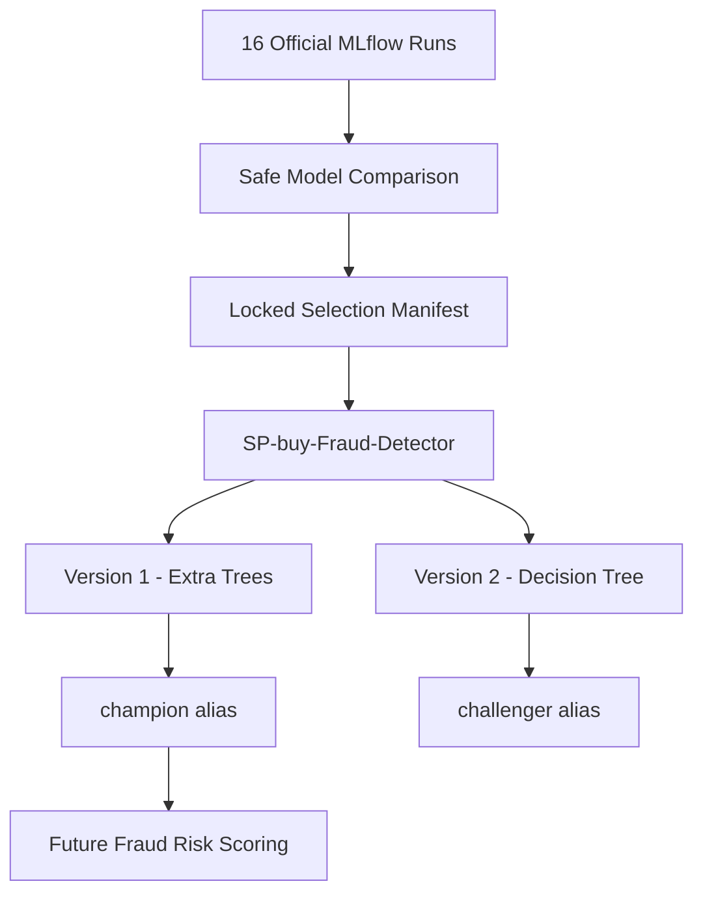

# MLflow Model Registry and Champion Promotion

## 1. Objective

Register the two selected fraud detection models from the historical
baseline experiments in the shared MLflow Model Registry and promote
the highest-ranked model as the CA1 champion.

Related tasks:
- #38: MLflow experiment tracking and model logging
- #39: Model comparison and top-two selection
- #40: Register the top two models and promote the champion

## 2. Registry Architecture

Registered model name: `SP-buy-Fraud-Detector`

Both selected models are stored as versions of one registered model.
Aliases identify their current roles independently of version numbers.



The single registered model design allows future evaluated models
to be registered under the same name without changing downstream
model identifiers.

## 3. Registered Models

| Attribute | Champion | Challenger |
|---|---|---|
| Version | 1 | 2 |
| Algorithm | Extra Trees | Decision Tree |
| Developer | Chu | Emi |
| Dataset | Safe | Safe |
| Alias | champion | challenger |
| Status | READY | READY |
| Decision threshold | 0.78125424937575 | 0.5660377358490566 |
| Production eligible | false | false |

### Source lineage

| Attribute | Champion | Challenger |
|---|---|---|
| Source run | chu_extra_trees_safe_v1 | emi_decision_tree_safe_v1 |
| Run ID | 2ad5cf74f0f040d9841767e94331af10 | f6d5330039164615bdd37dea09df56d0 |
| Logged model ID | m-a28a6f67e51042948058e9d96bb2c509 | m-8cf5204701264128b8e9eb066157ea78 |

Both versions originate from the original Safe dataset with SHA-256:

`656a05ca11891816989d51eeaf4c706aab2e9b38682fdf2112baf91f4fc32b93`

No model retraining or changes to the original experiment metrics
were required during registration.

## 4. Champion Selection Rationale

The selection follows the locked validation-only policy documented
in `docs/model_comparison.md` and `docs/top_two_models.json`.

The stakeholder prioritises high precision with reasonable recall.
A proposed technical comparison policy of at least 70% validation
precision was used to compare the Safe models consistently.

The 70% target is not a stakeholder-mandated numeric requirement.

Among the eligible models, Extra Trees achieved the highest
validation recall under the selected precision constraint.
Decision Tree achieved the second-highest validation recall.

| Metric | Extra Trees | Decision Tree |
|---|---:|---:|
| Validation precision | 70.04% | 70.23% |
| Validation recall | 16.64% | 15.27% |
| Validation AP | 0.513600 | 0.515972 |
| Test precision | 60.62% | 58.47% |
| Test recall | 21.33% | 18.75% |
| Test AP | 0.435033 | 0.417327 |

Extra Trees was selected based on validation performance.
The test results were used for subsequent performance assessment,
not to change the locked model ranking.

Both models fell below the proposed 70% precision target on
the test dataset. They remain CA1 demonstration candidates,
not production-approved models.

## 5. Implementation

| File | Responsibility |
|---|---|
| src/model_registry.py | Validate and register the locked top-two models |
| src/model_registry_verification.py | Verify version-based and alias-based inference |
| src/model_promotion.py | Assign and verify champion and challenger aliases |
| tests/test_model_registry.py | Automated unit and regression tests |
| docs/top_two_models.json | Locked selection manifest |

### Registration safeguards

The registration script validates:

- The official experiment and source run inventory.
- Safe dataset eligibility and dataset checksum.
- Source run IDs and logged model URIs.
- Logged model readiness.
- Registered version status and artifact lineage.
- Exact decision thresholds and required version tags.
- Existing versions to prevent duplicate registrations.

The script uses a read-only dry run by default.
Registry writes require the explicit `--apply` argument.

### Promotion safeguards

The promotion script:

- Requires both selected versions to exist.
- Verifies source lineage and version metadata.
- Rejects conflicting existing aliases.
- Reuses correctly assigned aliases.
- Verifies the resolved versions after promotion.
- Does not create additional model versions.

## 6. Version Metadata

Each registered version contains 22 metadata tags covering:

- Developer, algorithm and dataset version.
- Dataset checksum.
- Source run ID, run name and model URI.
- Selection rank, role, basis and policy.
- Proposed precision target.
- Original and selected decision thresholds.
- Validation precision, recall, F1 and average precision.
- Selection eligibility, exploratory status and production status.
- Registration scope.

The selected threshold is stored separately from the original
training threshold. Original experiment metrics are preserved.

## 7. Execution Instructions

Activate the project virtual environment and configure authorised
MLflow tracking and registry credentials.

Do not commit credentials or private server configuration.

### Preview registration

```powershell
python src/model_registry.py
```

### Register missing models

```powershell
python src/model_registry.py --apply
```

### Verify registered versions

```powershell
python src/model_registry_verification.py
```

### Preview promotion

```powershell
python src/model_promotion.py
```

### Apply promotion

```powershell
python src/model_promotion.py --apply
```

### Verify alias-based inference

```powershell
python src/model_registry_verification.py --aliases
```

Registration and promotion were executed repeatedly against
the shared MLflow server. Existing versions and aliases were
reused without creating duplicate versions.

## 8. Registered Model Inference Verification

The original logged models and their registered counterparts
were loaded and evaluated on the same chronological test split.

Test dataset:
- 144,122 orders
- 17,835 fraud orders
- 31 Safe features

Each verification mode covered 288,244 registered-model
predictions across the two selected models.

| Verification | Extra Trees | Decision Tree |
|---|---|---|
| Version-based loading | PASS | PASS |
| Alias-based loading | PASS | PASS |
| Source lineage | PASS | PASS |
| Threshold consistency | PASS | PASS |
| Probability consistency | PASS | PASS |
| Classification consistency | PASS | PASS |
| Evaluation metric consistency | PASS | PASS |

Maximum observed probability differences:

| Loading method | Extra Trees | Decision Tree |
|---|---:|---:|
| Registered version | 6.66e-16 | 0.0 |
| Registered alias | 7.77e-16 | 0.0 |

The negligible floating-point differences did not change
classification decisions or evaluation metrics.

Verification reports are generated locally at:

- `outputs/model_registry/verification_versions.json`
- `outputs/model_registry/verification_aliases.json`

## 9. Downstream Model Consumption

The current champion can be resolved using:

```python
import mlflow

client = mlflow.MlflowClient()

name = "SP-buy-Fraud-Detector"

version = client.get_model_version_by_alias(name, "champion")

threshold = float(version.tags["decision_threshold"])

model_uri = f"models:/{name}/{version.version}"

model = mlflow.sklearn.load_model(model_uri)

# X must contain the validated Safe features in the expected order.
probabilities = model.predict_proba(X)[:, 1]

predictions = (probabilities >= threshold).astype(int)
```

Resolve the alias once and load that exact version to keep the
model and threshold consistent during each scoring operation.

The registry threshold is metadata; it does not automatically
change the classifier's default `predict()` behaviour.

This example demonstrates model consumption for the CA1 workflow.
It does not grant production approval or replace the downstream
feature validation and risk scoring implementation.

## 10. Registration Issue and Resolution

During initial registration, MLflow successfully created Version 1
but returned `None` for the optional `ModelVersion.model_id` field.

The original verification logic incorrectly required this field
to match the logged model ID.

The verification logic was corrected to:

- Accept a missing optional model ID.
- Reject a conflicting non-empty model ID.
- Validate the registered source URI.
- Verify the original source run ID.
- Compare the resolved download URI with the logged artifact location.
- Identify existing versions by their source URI.

The corrected script reused Version 1 and registered only the
remaining Decision Tree model.

This behaviour is covered by automated regression tests.

## 11. Automated Testing

### Registry unit tests

```powershell
python -m pytest tests/test_model_registry.py -v
```

Result: 42 passed, 14 warnings in 7.28 seconds.

Coverage includes manifest validation, optional model IDs,
artifact lineage, metadata integrity, partial registration recovery,
duplicate protection, alias conflicts and prediction consistency.

### Full repository regression tests

```powershell
python -m pytest tests -q -rs
```

Result:

- 105 passed, including the 42 registry unit tests.
- 0 failed.
- 1 skipped.
- 31 subtests passed.
- 14 dependency deprecation warnings.
- Execution time: 45.09 seconds.
- Exit code: 0.

The existing MLflow logging integration test requires a local
server. Its initial failure was caused by the active shared
Tailscale tracking URI.

The full suite was subsequently executed using an isolated
temporary MLflow 3.18.0 Docker container on port 5007, without
mounting any existing Docker volumes.

The ETL database integration test was skipped because the
separate `ETL_TEST_DATABASE` practice database was not configured.

The dependency warnings originated from Matplotlib and Pyparsing.

## 12. Post-test Shared Server Verification

After restoring the shared MLflow environment, the following
checks were completed successfully:

| Check | Result |
|---|---|
| Official experiment ID | 2 |
| Official active runs | 16 |
| Official run status | All FINISHED |
| Registered versions | 2 |
| Champion alias | Version 1 |
| Challenger alias | Version 2 |
| Unexpected logging test experiment | None detected |
| Shared server inventory verification | PASS |

The temporary test container was stopped after verification.
The shared server remained running.

## 13. Limitations

- Both registered models are CA1 demonstration candidates and
  retain `production_eligible=false`.
- Test precision is below the proposed comparison target.
- Recall remains limited, requiring further model improvement.
- The baseline scripts are specific to the locked historical
  experiment and are not a general automated retraining registry.
- Registration and promotion are repeat-safe for sequential
  execution but do not implement concurrent execution locks.
- Multiple alias assignments are not an atomic transaction.
- Future retrained models require fresh evaluation before
  champion promotion.
- The ETL database integration test was not executed.
- The shared local server depends on the host laptop, Docker
  and private network connectivity.

## 14. Completion Summary

The two locked Safe models were registered successfully in the
shared MLflow Model Registry.

Extra Trees Version 1 is the CA1 champion and Decision Tree
Version 2 is the challenger.

Both models were verified through their version numbers and
aliases, with source lineage, thresholds, predictions and
evaluation metrics preserved.

Sequential repeat-safe registration and promotion were verified
against the shared server. Automated tests and the isolated
full regression test suite completed without failures.
