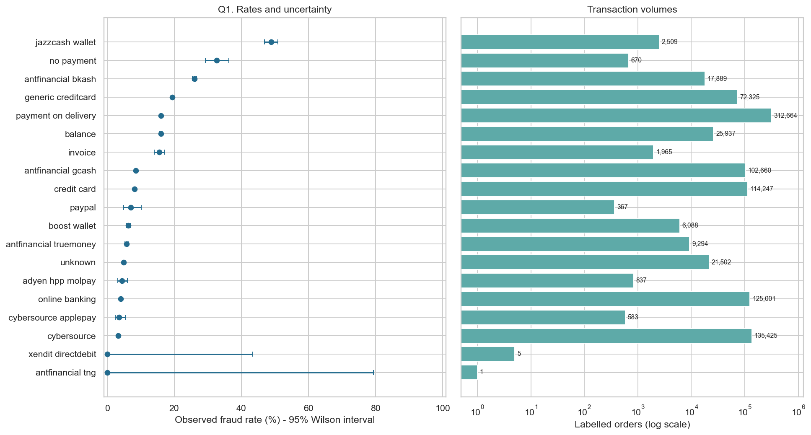
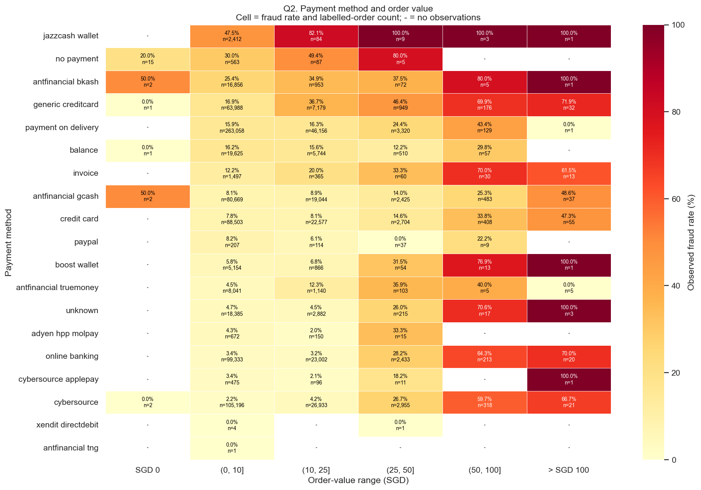
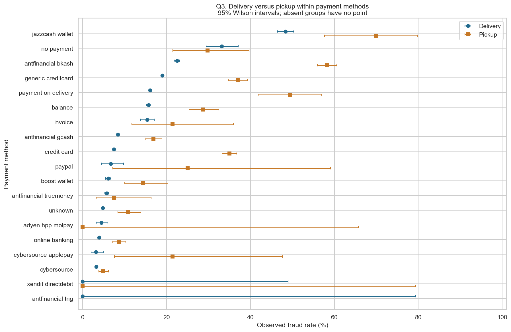

# Payment and order-pattern analytics - Chu

## Task #63 and individual submission A1

This work answers three Trust & Safety questions using the latest cleaned data
in the team's existing **spbuy AWS RDS MySQL database**. It does not copy the
group dataset into a separate database or rely on a static local CSV.

| Deliverable | Location |
|---|---|
| Reusable SQL and Python analysis | `src/analytics_payment_order_chu.py` |
| Executed explanatory notebook | `notebooks/payment_order_analytics_chu.ipynb` |
| SQL/calculation/export tests | `tests/test_analytics_payment_order_chu.py` |
| Reviewed aggregate evidence | `docs/evidence/task63_chu/` |

The notebook documents definitions, runs the analysis, shows all three figures
and relevant tables, and generates interpretations from the current results.
It can be used to explain the code during the individual demonstration.

## Population and calculations

The unit of analysis is a **labelled order**. The SQL joins `fraud_labels` to
`orders` using both `country_code` and `order_id`. Customer snapshot fields are
not needed for these three payment/order questions. Unlabelled orders are
reported separately rather than treated as legitimate transactions.

Fraud rate is `SUM(is_fraud) / COUNT(labelled orders)` within the relevant
group. Rates are order-weighted, not averages of country percentages.
`risk_lift` compares a group with the overall labelled-order baseline;
`within_method_lift` compares a value band with its own payment-method baseline.
All comparisons retain their order and fraud counts.

The assignment appendix defines `order_value` in SGD. Common fixed bands are
used across payment methods: zero, `(0,10]`, `(10,25]`, `(25,50]`, `(50,100]`
and above 100 SGD. Round, fixed boundaries are easy for analysts to interpret
and remain stable between executions. Exact upper bounds belong to the lower
band. These are descriptive reporting ranges, not optimised fraud thresholds.

Valid zero-value orders, `no payment` and the cleaned `unknown` payment segment
are retained. `unknown` represents missing payment information; it should not
be treated as a named payment provider. Invalid values or unmatched label/order
records stop the analysis with an error so they cannot silently alter rates.

SQL performs one aggregate retrieval at country/payment/value-band/collection
grain. Python then implements three separate analytical queries through
`query_payment_methods`, `query_order_values` and `query_collection_types`.
This keeps the questions independently readable while using one consistent,
fresh aggregate state rather than repeatedly downloading about 950,000 orders.

Intervals are 95% Wilson binomial intervals. Every group is exported and plotted.
A minimum of 100 labelled orders is used only for automatically highlighted
examples, to avoid making a one-order segment the headline. This is a reporting
support rule, not a statistical guarantee or a transaction-blocking rule.

## Live RDS execution - 29 November 2026

The original notebook completed all seven code cells against live RDS. That
analysis read 949,969 labelled orders, including 104,433 fraud labels: an overall
observed fraud rate of **10.99%**. There were 24 unlabelled orders outside the
rate denominator. Order dates range from 12 November 2022 to 11 May 2023.

The cohort contains 19 payment methods and five countries (BD, MY, PH, PK, TH).
One standalone run completed in **25.93 seconds**. The executed notebook's run
completed in **25.41 seconds**, including a 24.14-second database read. These
are measured practice timings on the current data and service connections.

The expanded presentation contains 19 code cells, checked against the saved
aggregate snapshot without another live RDS read. It adds explicit methods,
worked calculations, separate insights and investigation decisions, and a
combined conclusion. Normal notebook execution still retrieves fresh RDS data.

### Q1. Which payment methods have the highest fraud rates, taking transaction volumes into account?

**Code:** `query_payment_methods()`; notebook section 6.

Among methods with at least 100 labelled orders, **jazzcash wallet** has the
highest observed rate: **48.90%**, based on 1,227 fraud-labelled orders out of
2,509. Its descriptive 95% interval is 46.95-50.86%.

**Payment on delivery** contributes the largest number of fraud-labelled orders:
50,274, or **48.14% of observed fraud**, at a **16.08%** rate across 312,664
labelled orders. The highest rate and the largest fraud volume therefore point
to different investigation considerations.

**Investigation implication:** investigate the high-rate wallet segment while
allocating review capacity with the large payment-on-delivery fraud volume in
mind. Check country-specific results and label coverage before changing controls.
Tiny groups with zero observed fraud are not established as safe.



### Q2. Within each payment method, how do fraud rates differ across order-value ranges?

**Code:** `query_order_values()`; notebook section 7.

The largest within-method lift among value groups with at least 100 labelled
orders is **cybersource, above SGD 50 through SGD 100**: **59.75% fraud**, or
190 of 318 labelled orders. This is **18.19 times** cybersource's overall
method baseline of **3.29%**. That does not imply that all cybersource orders,
or all high-value orders, have this rate.

**Investigation implication:** add the supported payment/value combination to
the review candidates, using both its rate and absolute fraud count. Inspect
the country/payment/value table for composition effects. Very high percentages
in one- or two-order cells are shown with counts but are not headline evidence.



### Q3. How do fraud rates differ between delivery and pickup orders across payment methods?

**Code:** `query_collection_types()` and `collection_gaps()`; notebook section 8.

For methods with at least 100 labelled orders in both groups, **antfinancial
bkash** has the largest absolute collection-type gap: **22.48%** for Delivery
(16,140 labelled orders) versus **58.26%** for Pickup (1,749 labelled orders).
The Delivery-minus-Pickup difference is **-35.78 percentage points**.

**Investigation implication:** examine the payment/collection combination rather
than applying a single risk assumption to every pickup order. Check country
composition and uncertainty before implementing controls. Where a method has
no recorded orders for one collection type, its comparison is undefined rather
than a zero-risk result.



## Limits and refreshed findings

These are retrospective associations, not causal effects or fraud predictions.
Customers can contribute multiple orders, and labelled data may be selected
differently from unlabelled data. Wilson intervals do not account for all such
dependence or guarantee future performance. Country-specific companion tables
are included because payment-method availability and transaction mixes differ.

The numbers above are a dated execution snapshot. The Python-generated findings
and notebook outputs are recalculated when run on updated RDS data; chart
headings do not hard-code a conclusion such as “all pickup orders are riskier.”

## Run and verify

Configure the existing `DB_HOST`, `DB_PORT`, `DB_USER`, `DB_PASSWORD` and
`DB_NAME=spbuy` environment variables in the terminal. See
[resource configuration](resource_configuration.md). Start the notebook kernel
from that environment. Credentials are not stored in the notebook or source.

```powershell
.venv\Scripts\python.exe src/analytics_payment_order_chu.py
.venv\Scripts\python.exe -m pytest tests/test_analytics_payment_order_chu.py -q --disable-warnings
```

Each analysis execution creates a new `outputs/analytics_chu/<run-id>/` folder
containing eight aggregate CSV tables, three PNG figures, generated findings
and metadata/timings. There are no customer or order identifiers in these
aggregate exports. Reviewed evidence is copied under `docs/evidence/task63_chu/`.

**Eight tests passed.** They execute the actual aggregate SQL against isolated
SQLite fixtures and cover country/order composite keys, unlabelled-order
exclusion, value-band boundaries, valid zeros, within-method baselines,
collection gaps, absent groups, uncertainty, fresh reads after label updates,
invalid input rejection, changed insights and saved figures/tables. These
tests do not replace the live MySQL check, which was performed separately.

## Acceptance criteria and next integration

| Task #63 criterion | Evidence |
|---|---|
| Three independent analytical questions using latest RDS data | Three named query functions, executed standalone and in the notebook |
| Payment, value-range and collection analysis | Q1, Q2 and Q3 tables, figures and companion country breakdowns |
| Relevant transaction counts | Orders/frauds in every result; counts on Q1/Q2 figures and paired Q3 tables |
| Appropriate tables and visualisations | Eight aggregate tables and three reviewed figures |
| Investigation-related interpretation | Each question has generated findings, a decision implication and limitations |
| Document code, outputs and insights | Reusable module, executed notebook, this guide and aggregate evidence |

For individual template A1, use the three question sections above with the code
locations, figures and insights. The reusable `load_counts`, `analyse` and
`save_outputs` functions are ready for the subsequent Prefect work. Task #63
does not itself implement or claim completion of the Prefect flow or optional
AWS deployment requirements.
