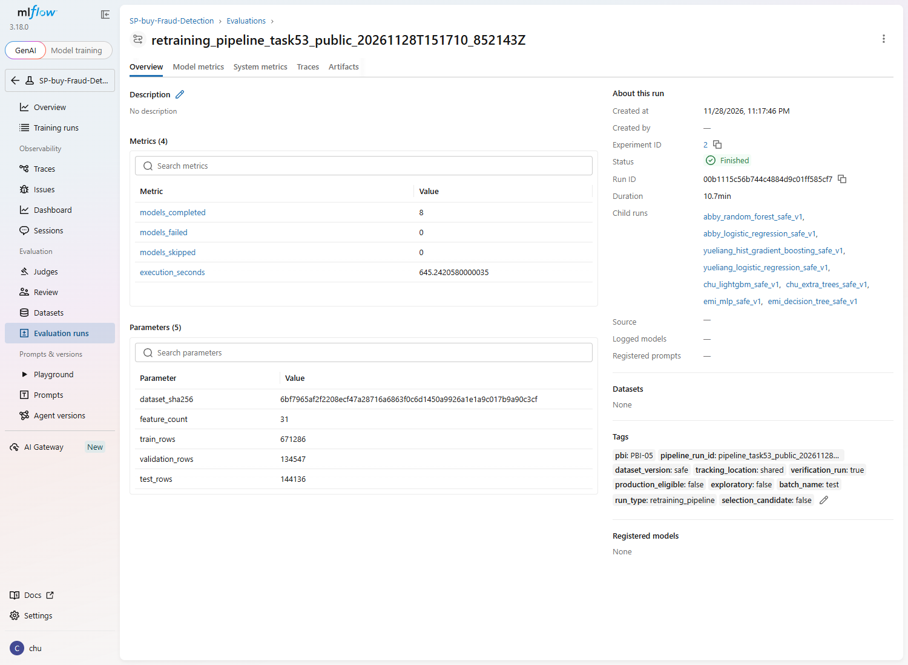
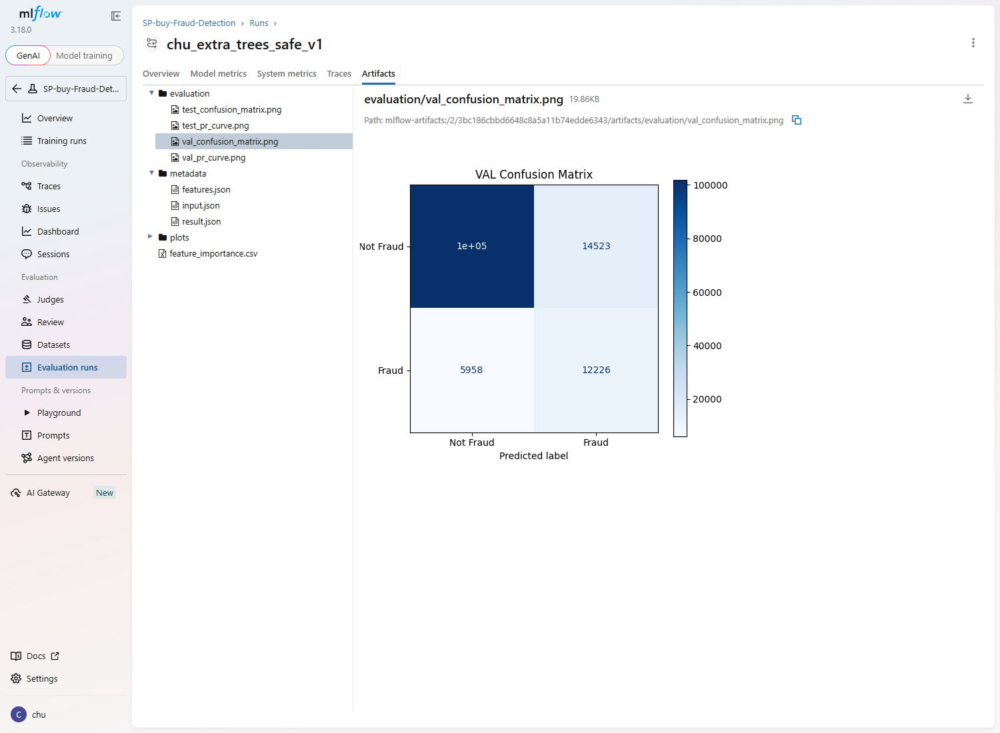

# Automated pipeline testing - Task #53

## Scope

Task #53 tests the integrated URL-to-RDS-to-retraining-to-MLflow workflow. The
valid-input test uses the public school practice files directly:

| Input | Public URL |
|---|---|
| Customers | https://liuzheng1990.github.io/teaching/data/mlops/customers_test.csv |
| Orders | https://liuzheng1990.github.io/teaching/data/mlops/orders_test.csv |
| Labels | https://liuzheng1990.github.io/teaching/data/mlops/labels_test.csv |

All three public downloads were checked against the previously approved
practice files and matched byte for byte. This is practice-data verification;
it does not establish a result for the tutor's future unseen interview batch.

The Task #53 acceptance criterion measures **ETL within 180 seconds**. The
pipeline's ETL-stage duration includes extraction, cleaning/transformation and
RDS loading. Feature preparation, model training, MLflow logging and the full
pipeline duration are reported separately. The confirmed scope for this task,
clarified during verification on 28 November 2026, is **ETL only**. Model
retraining and shared logging must complete successfully; their duration is
reported for information rather than compared with the ETL limit.

## Reproduce the valid-input test

Keep RDS, shared MLflow and Tailscale available. Configure the existing `DB_*`
and `MLFLOW_TRACKING_*` environment variables in the terminal; follow
`resource_configuration.md`. Use an individual MLflow account with EDIT access
to the existing experiment. No credentials belong in commands committed here.

From the repository root, run:

```powershell
.venv\Scripts\python.exe src/automated_pipeline.py --customers "https://liuzheng1990.github.io/teaching/data/mlops/customers_test.csv" --orders "https://liuzheng1990.github.io/teaching/data/mlops/orders_test.csv" --labels "https://liuzheng1990.github.io/teaching/data/mlops/labels_test.csv" --verification-run
```

The command loads the practice data into the shared RDS database using the
existing upsert/rejection rules. It then reads the combined state, prepares the
Safe features and chronological partitions, and fits/logs all eight models.
Practice runs are excluded from model selection. Repeated executions create new
pipeline and MLflow run IDs; existing practice records are updated by key.

On success, use the printed top-level summary path:

```powershell
.venv\Scripts\python.exe src/verify_pipeline_execution.py --summary outputs/pipeline/YOUR_PIPELINE_ID/summary.json
```

This command verifies the saved evidence and existing shared MLflow records. It
does not rerun ETL or fit models. It checks completed/ordered stages, accepted
labels, all eight required Safe tasks, the frozen input checksum, evaluation
metrics and model artifacts. It writes `pipeline_verification.json` beside the
top-level summary. A failed check or ETL time above 180 seconds returns exit code
1. `--skip-mlflow` explicitly checks only local evidence and reports
`local_checks_passed`, rather than a shared-server verification pass.

## Reliability tests

```powershell
.venv\Scripts\python.exe -m pytest tests/test_pipeline_reliability.py tests/test_verify_pipeline_execution.py tests/test_automated_pipeline.py tests/test_etl_pipeline.py -q --junitxml=outputs/task53_local_tests.xml
```

The Task #53 failure tests use actual temporary HTTP downloads and isolated
SQLite batch-state fixtures. Database writes/model fitting are substituted in
these fault scenarios. No faults are injected into production RDS or the shared
MLflow server.

| Scenario | Expected outcome |
|---|---|
| HTTP 404 for one required CSV | Retry download; fail ETL; block writes and training |
| Downloaded CSV missing required columns | Fail validation before database loading or training |
| Simulated database write failure | Record failed ETL; block dependent stages |
| Invalid CLI source URL | Argument error and exit code 2 before contacting services |
| Earlier completed marker followed by a failed ETL attempt | Block training despite the stale marker |
| Dry run, incomplete/mismatched batch or zero accepted labels | Block training |
| Model or MLflow logging failure | Fail the execution and skip dependent work |
| Modified prepared snapshot | Reject verification because the checksum changed |
| Missing model tasks, overlapping stages or inconsistent timings | Reject verification |
| ETL duration of exactly 180 seconds / above 180 seconds | Pass / fail the ETL performance check |
| ETL below 180 seconds with longer full execution | Report ETL pass and the longer total separately |

On 28 November 2026, these four suites produced **36 passing tests**, one skipped
opt-in MySQL test and 14 passing subtests. The MySQL-specific transaction and
rollback scenario remains an opt-in test in a separate practice database; the
local substituted-write test does not prove real MySQL rollback by itself.

## Live public-URL result

The public-URL execution on **28 November 2026 passed**:

- Pipeline ID: `pipeline_task53_public_20261128T151710_852143Z`.
- Shared experiment: `SP-buy-Fraud-Detection` (experiment 2).
- Parent run: `00b1115c56b744c4884d9c01ff585cf7`.
- Eight new child runs and eight trained models completed successfully.
- All saved model names matched their descriptive source-run names.
- Shared read-back matched parameters, thresholds and Validation/Test metrics,
  checked required artifacts and downloaded all eight model descriptors.

The practice records were already in RDS from the earlier Task #52 check, so
this run verified updates and repeatability. It updated 100 customers, 104
orders and 97 valid labels, inserted no duplicate records, and rejected the
same 7 labels with missing customers. RDS retained 901,412 customers, 949,993
orders and 949,969 fraud labels. The `test` batch was completed before retraining.

The combined Safe snapshot contained 949,969 labelled orders and 31 features:
671,286 Train, 134,547 Validation and 144,136 Test rows. The date anchor remained
11 May 2023. No extra CSV append occurred after the database load.

| Stage | Duration |
|---|---:|
| Service preflight | 6.96 s |
| **ETL: extraction, cleaning/transformation and RDS load** | **8.21 s - PASS against 180 s** |
| Committed-batch validation | 0.85 s |
| Feature preparation, eight models and shared logging | 646.67 s |
| Complete integrated execution (informational) | 662.71 s, approximately 11 min 3 s |

Audit, artifact read-back and screenshot capture happened after the integrated
command and are not included in these timings. A before/after audit confirmed
that all **49 pre-existing experiment records**, both registered models, their
four versions and all existing aliases were unchanged. Verification runs did
not become selection candidates or trigger model promotion.

## Acceptance-criteria evidence

| Task #53 criterion | Result and evidence |
|---|---|
| Execute using valid customer, order and label CSV URLs | PASS: all three public HTTPS URLs above were supplied to the actual integrated CLI |
| Verify successful AWS RDS loading | PASS: accepted/rejected counts matched an independent preflight; completed batch and database counts checked after execution |
| Automatically trigger all required model tasks on updated labelled data | PASS: eight Safe tasks completed using one frozen combined RDS snapshot |
| Record new MLflow experiments, evaluation metrics and artifacts | PASS: new parent/eight children, trained models and evaluation artifacts verified through the shared API |
| Test invalid inputs and execution failures | PASS: local HTTP/schema/CLI failures, simulated write failures and existing pipeline failure regression cases passed; faults were not injected into production |
| Verify ETL completes within three minutes | PASS: 8.21 seconds, including extraction, transformation and RDS loading |
| Complete retraining/logging without manual intervention | PASS: one integrated invocation completed all stages and all model tasks |
| Document results, logs and screenshots | PASS: this guide and the evidence files below |

## Submission evidence

These small, reviewed evidence files can be committed with the group submission:

- [Machine-readable live results](evidence/task53/results.json): public sources,
  timings, accepted/rejected counts, partition sizes, model/run identities and
  evaluation results.
- [Verification command result](evidence/task53/verification.json): the new CLI
  also passed against the real execution, including all eight shared-model
  checks and the ETL-only performance gate; it returned exit code 0.
- [Redacted execution log](evidence/task53/execution.log.txt): the actual public-URL
  run output; the private tracking hostname and local repository path are redacted.
- [Local test results](evidence/task53/local_tests.xml): JUnit results, including
  the opt-in MySQL skip. JUnit counts include the 14 subtests.
- [Completed pipeline screenshot](evidence/task53/pipeline_completed.png).
- [Model evaluation artifact screenshot](evidence/task53/extra_trees_artifacts.png).
- [Experiment runs screenshot](evidence/task53/experiment_runs.png).

The screenshots are captures of the authenticated shared MLflow UI. The parent
shows eight completed models, zero failures and zero skipped models. The
representative Extra Trees artifact page shows evaluation plots and metadata;
the shared API checks cover all eight algorithms.





Full raw inputs, prepared data, fitted model files and unsanitised local logs
remain git-ignored under `outputs/`. This run's detailed working evidence is in
`outputs/task53_live_validation/20261128T151710_852143Z/` and
`outputs/pipeline/pipeline_task53_public_20261128T151710_852143Z/`.

The result establishes successful practice execution under the measured
conditions. The unseen interview batch and different network/server conditions
will still be evaluated when the tutor supplies those inputs.
