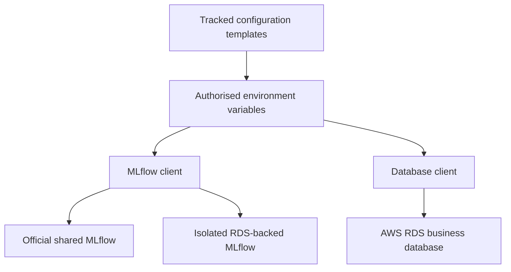

# Externalised Resource Configuration Guide

## 1. Purpose

This guide documents the resource configuration improvements
implemented under PBI 06 (#20), Task #58.

The objectives are to:

- Separate resource connection settings from application code.
- Remove outdated hard-coded MLflow tracking endpoints.
- Protect sensitive credentials from version control.
- Provide reusable configuration templates.
- Allow team members to connect to MLflow and AWS RDS without
  modifying application source code.

The existing official shared MLflow server remains the team's
official experiment tracking environment.

## 2. Configuration Audit

An initial configuration audit covered 51 committed Python
and notebook files.

Of these, 44 contained configuration-related candidates.
These candidates included environment variable references,
documentation examples, local storage paths, validation logic
and potential hard-coded resource values.

A targeted inspection was subsequently performed to distinguish
actual configuration issues from acceptable defaults and
documentation references.

### Audit Findings and Decisions

| Component | Finding | Decision |
|---|---|---|
| src/database.py | Database settings already read from environment variables | Preserve existing connection logic |
| src/mlflow_utils.py | Tracking URI already externally configured | Preserve |
| src/model_utils.py | Configurable tracking URI with local SQLite fallback | Preserve |
| src/retraining_tracking.py | External configuration and URI validation | Preserve |
| Model comparison and selection scripts | Configurable tracking URI | Preserve |
| Model registry and promotion scripts | External URI configuration and validation | Preserve |
| Logistic Regression notebook | Fixed port 5004 fallback and assertion | Replace |
| Random Forest notebook | Fixed port 5004 fallback and assertion | Replace |
| Database module documentation | Actual RDS endpoint in docstring | Replace with placeholder |
| Project-level configuration template | Missing | Add root .env.example |
| Unit test credentials | Synthetic negative-test values | Preserve |

Repository-relative SQLite storage and configurable non-sensitive
defaults were retained where they supported existing development
workflows.

Machine-specific data preparation paths were identified but were
not modified because they are outside the primary MLflow and
database connection scope of this task.

## 3. Configuration Architecture



The MLflow client connects to one selected tracking environment
at a time.

The database client connects to the existing SP-buy business
database.

The isolated MLflow metadata database must not be used as the
business database for ETL or analytics.

## 4. Configuration Files

| File | Purpose |
|---|---|
| .env.example | Project-level client configuration template |
| mlflow_server/local_deploy/.env.example | Official MLflow server configuration |
| mlflow_server/local_deploy/auth_config.ini.example | Official server authentication template |
| mlflow_server/rds_deploy/.env.example | Isolated RDS-backed server configuration |
| mlflow_server/rds_deploy/auth_config.ini.example | Isolated server authentication template |

The actual runtime configuration files are excluded from Git.

The project-level template does not contain real credentials.

The existing application reads process environment variables.
Copying `.env.example` to `.env` alone does not automatically
load those variables.

No additional configuration framework or python-dotenv
dependency was introduced.

## 5. MLflow Client Configuration

### 5.1 Select the Tracking Environment

| Environment | Tracking URI | Purpose |
|---|---|---|
| Official shared server | Authorised private HTTPS endpoint | Normal team experiment tracking |
| Official server on host machine | http://127.0.0.1:5006 | Local host access |
| Isolated RDS-backed server | http://127.0.0.1:5007 | Infrastructure testing |

Team members should normally use the authorised private HTTPS
endpoint and their individual MLflow accounts.

The localhost endpoints are accessible from the hosting machine,
not from other team members' computers.

The isolated RDS-backed server is not the official team
experiment tracking environment.

### 5.2 Required Environment Variables

| Variable | Description |
|---|---|
| MLFLOW_TRACKING_URI | Selected tracking server endpoint |
| MLFLOW_TRACKING_USERNAME | Authorised MLflow account |
| MLFLOW_TRACKING_PASSWORD | Password for the selected MLflow account |

### 5.3 Configure MLflow Using PowerShell

Run the following commands from the project repository.

Replace the endpoint placeholder with the authorised endpoint
provided by the team.

```powershell
$env:MLFLOW_TRACKING_URI = "YOUR_AUTHORISED_MLFLOW_ENDPOINT"

$credential = Get-Credential -Message "Enter MLflow credentials"

$env:MLFLOW_TRACKING_USERNAME = $credential.UserName

$env:MLFLOW_TRACKING_PASSWORD = $credential.GetNetworkCredential().Password

Remove-Variable credential
```

Do not embed usernames or passwords directly in the tracking URI.

Do not commit real credentials to Git or include them in
documentation, screenshots or issue comments.

Environment variables configured this way apply to the current
PowerShell process and its child processes.

Launch Python or Jupyter from the configured session so that
the application inherits these variables.

Already running notebook kernels may need to be restarted after
configuration changes.

### 5.4 Notebook Configuration

The Logistic Regression and Random Forest notebooks previously
used a fixed fallback endpoint on port 5004.

This outdated configuration was removed.

The notebooks now read the tracking endpoint from:

```python
configured_tracking_uri = os.environ.get("MLFLOW_TRACKING_URI")
```

A clear error is raised when the variable is missing.

The existing tracking URI assertions were also updated to
validate the selected external endpoint rather than a fixed
server address.

The original training and evaluation logic was preserved.

Historical notebook outputs were retained and may still contain
references to the previous tracking environment.

Existing MLflow run IDs are server-specific. Do not resume
historical runs on another tracking server unless the relevant
runs exist there.

## 6. AWS RDS Business Database Configuration

### 6.1 Required Environment Variables

| Variable | Description | Default |
|---|---|---|
| DB_HOST | Authorised RDS endpoint | Required |
| DB_PORT | MySQL connection port | 3306 |
| DB_USER | Authorised business database account | Required |
| DB_PASSWORD | Business database account password | Required |
| DB_NAME | Target business database | spbuy |

Obtain the actual RDS endpoint and authorised account details
from the database owner.

### 6.2 Configure the Database Using PowerShell

```powershell
$env:DB_HOST = "YOUR_RDS_ENDPOINT"
$env:DB_PORT = "3306"
$env:DB_NAME = "spbuy"

$credential = Get-Credential -Message "Enter business database credentials"

$env:DB_USER = $credential.UserName
$env:DB_PASSWORD = $credential.GetNetworkCredential().Password

Remove-Variable credential
```

The existing `src/database.py` module retrieves these settings
through `get_db_config()`.

The existing `get_engine()` function constructs the connection
using SQLAlchemy URL.create() and PyMySQL.

No changes to the existing database connection logic were
required.

The actual RDS endpoint in the module docstring was replaced
with a generic placeholder.

## 7. Credential Separation

The following credentials have different purposes and must not
be used interchangeably.

| Credential | Purpose |
|---|---|
| Official MLflow account | Experiment tracking on the official server |
| Isolated MLflow account | Infrastructure testing on the RDS-backed server |
| DB_PASSWORD | Existing SP-buy business database connection |
| MLflow metadata database account | Internal connection between the isolated MLflow server and RDS |
| MLflow server secret key | Server-side application security configuration |

The dedicated MLflow metadata database account is not intended
for ETL, analytics or business data access.

Prefer individual authorised MLflow accounts for normal team
workflows rather than sharing administrator credentials.

## 8. Connection Verification

### 8.1 MLflow Verification

The following read-only test verifies that the configured
tracking endpoint and credentials can access the official
experiment.

```python
import os
import mlflow
from mlflow import MlflowClient

uri = os.environ["MLFLOW_TRACKING_URI"]

mlflow.set_tracking_uri(uri)
client = MlflowClient()

experiment = client.get_experiment_by_name(
    "SP-buy-Fraud-Detection"
)

assert experiment is not None

runs = client.search_runs(
    experiment_ids=[experiment.experiment_id],
    max_results=1
)

assert runs

print("Externalised MLflow connection: PASS")
```

This test is intended for the official team environment.

### Observed Results

| Verification | Result |
|---|---|
| Required environment variables | 3/3 CONFIGURED |
| Tracking URI matches external configuration | PASS |
| Authenticated connection | PASS |
| Official experiment retrieval | PASS |
| Experiment ID | 2 |
| Existing run retrieval | PASS |
| Model training executed | NO |
| MLflow records modified | NO |

An initial connection attempt failed. After loading the
credentials associated with the selected official server,
the subsequent verification passed.

This highlights the importance of keeping credentials for
different MLflow environments separate.

### 8.2 RDS Verification

The existing project database functions were used to verify
the externally configured business database connection.

```python
import sys
from pathlib import Path
from sqlalchemy import text, inspect

sys.path.insert(0, str(Path("src").resolve()))

from database import get_db_config, get_engine, EXPECTED_TABLES

config = get_db_config()
engine = get_engine(config=config)

try:
    with engine.connect() as conn:
        assert conn.execute(text("SELECT 1")).scalar() == 1

        database = conn.execute(
            text("SELECT DATABASE()")
        ).scalar()

        assert database == "spbuy"

    tables = set(inspect(engine).get_table_names())
    assert set(EXPECTED_TABLES).issubset(tables)

    print("Externalised RDS connection: PASS")

finally:
    engine.dispose()
```

### Observed Results

| Verification | Result |
|---|---|
| Required environment variables | 5/5 CONFIGURED |
| Existing get_db_config() | PASS |
| Existing get_engine() | PASS |
| Connection settings match external configuration | PASS |
| Database authentication | PASS |
| SQL query execution | PASS |
| MySQL version | 8.4.11 |
| Selected database | spbuy |
| Session TLS encryption | ACTIVE |
| Expected business tables | 5/5 AVAILABLE |
| ETL executed | NO |
| Database records modified | NO |

The following business tables were verified:

- customers
- orders
- fraud_labels
- rejected_records
- etl_batches

The observed database session used TLS encryption.

Certificate verification and hostname verification were not
independently established for this business database connection.

## 9. Security Verification

### 9.1 Runtime Configuration Protection

The following runtime files were verified as ignored and
untracked:

- .env
- mlflow_server/local_deploy/.env
- mlflow_server/local_deploy/auth_config.ini
- mlflow_server/rds_deploy/.env
- mlflow_server/rds_deploy/auth_config.ini
- mlflow_server/rds_deploy/rds-ca.pem

All five configuration templates were verified as present
and available for version control.

### 9.2 Credential Screening Results

| Verification | Result |
|---|---:|
| Runtime configuration protection | 6/6 PASS |
| Configuration templates | 5/5 PASS |
| Text files screened | 75 |
| Available runtime secrets checked | 2 |
| Tracked sensitive configuration filenames | 0 |
| Historical sensitive filename candidates | 0 |
| Credential pattern candidates | 1 |
| Candidates classified as synthetic test credentials | 1 |
| Unresolved candidates | 0 |

The single credential pattern candidate was found in:

`tests/test_retraining_tracking.py`

Further inspection identified common dummy credentials in the
following negative unit test:

`test_shared_configuration_requires_explicit_https_and_individual_account`

The candidate did not match the available runtime secrets
checked during classification.

The test uses assertRaisesRegex to verify rejection of
invalid configuration.

The test was retained because the synthetic credential values
serve a legitimate validation purpose.

### 9.3 Security Screening Limitations

The verification was a targeted coursework security screening,
not an exhaustive secret detection or penetration test.

The Git history check covered selected sensitive filenames
across locally available Git references.

It did not scan every historical file version, binary file
or archived deployment package for embedded secrets.

No unresolved credential candidates remained within the
screened scope.

## 10. Troubleshooting

| Problem | Recommended action |
|---|---|
| MLFLOW_TRACKING_URI missing | Configure the environment variable before launching Python |
| MLflow authentication failure | Confirm credentials belong to the selected server |
| MLflow connection refused | Verify the selected server is running and accessible |
| Missing experiment | Confirm that the intended tracking environment is selected |
| Historical run ID not found | Verify that the run exists on the selected tracking server |
| DB_HOST, DB_USER or DB_PASSWORD missing | Configure the required database variables |
| Database authentication failure | Confirm the authorised business database account |
| RDS connection failure | Check Learner Lab availability and existing network permissions |
| Environment variables not visible in Jupyter | Restart or launch the kernel from the configured session |

Do not resolve configuration errors by hard-coding actual
credentials into application source code.

## 11. Session Cleanup

When the configured PowerShell session is no longer required,
remove its sensitive environment variables or close the session.

```powershell
Remove-Item Env:MLFLOW_TRACKING_PASSWORD -ErrorAction SilentlyContinue
Remove-Item Env:DB_PASSWORD -ErrorAction SilentlyContinue
```

Do not remove credentials from an active session that is still
being used by a required project workflow.

Previously launched child processes may retain their inherited
environment variables until those processes are closed.

## 12. Implementation Evidence

Detailed verification evidence is recorded in GitHub Issue #58.

| Screenshot | Evidence |
|---|---|
| 01 | Configuration security verification |
| 02 | Credential false positive verification |
| 03 | Externalised notebook configuration |
| 04 | Externalised MLflow connection verification |
| 05 | Externalised RDS connection verification |

## 13. Acceptance Criteria Verification

- [x] Identify hard-coded resource connection configurations.
- [x] Replace outdated fixed connection settings with external
  environment configuration.
- [x] Verify sensitive configuration protection within the
  inspected repository scope.
- [x] Provide safe and reusable configuration templates.
- [x] Verify MLflow and database connections using external
  environment variables.
- [x] Document the configuration process for team members.

## 14. Limitations and Follow-up

- Full model notebook execution was not repeated.
- Existing historical notebook outputs were preserved.
- Existing model and database connection logic was retained.
- The security screening was not an exhaustive Git history
  secret scan.
- Business database TLS certificate and hostname verification
  were not independently established.
- No managed secret storage service was introduced.
- No changes were made to the existing MLflow deployments.

Infrastructure restart, persistence and reliability verification
will be addressed under #59.

## 15. Related Documentation

- [Official MLflow Deployment](../mlflow_server/local_deploy/README.md)
- [RDS-backed MLflow Deployment](../mlflow_server/rds_deploy/README.md)
- [MLflow Architecture Evaluation](mlflow_architecture_evaluation.md)
- [Project Configuration Template](../.env.example)

Related issues: #20, #56, #57, #58 and #59.
