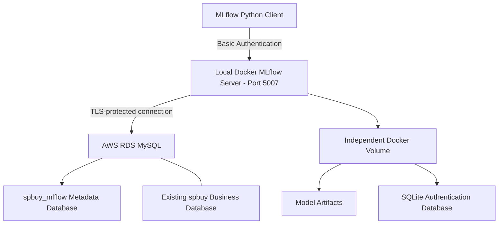

# RDS-backed MLflow Deployment

## 1. Purpose

This deployment implements the selected hybrid MLflow architecture
under PBI 06 — More Robust MLflow System Architecture (#20).

It follows the architecture feasibility evaluation in #56 and the
implementation requirements in #57.

The objectives are to:

- Externalise MLflow tracking metadata from the local SQLite database.
- Reuse the existing AWS RDS MySQL instance.
- Establish TLS-protected database connectivity.
- Restrict database access through a dedicated database account.
- Retain persistent local model artifact storage.
- Preserve the existing authenticated shared MLflow environment.
- Verify compatibility with the project's existing training workflow.

This deployment is an isolated architecture improvement and does not
replace the official shared MLflow server.

## 2. Implemented Architecture



The existing SP-buy business database and the new MLflow metadata
database reside on the same RDS instance but have separate access
permissions.

The MLflow database account cannot access the existing business database.

### Deployment Comparison

| Component | Official Deployment | Improved Deployment |
|---|---|---|
| Application hosting | Local Docker | Local Docker |
| Python version | 3.12 | 3.12 |
| MLflow version | 3.18.0 | 3.18.0 |
| Metadata backend | SQLite | AWS RDS MySQL |
| Database driver | SQLite | PyMySQL 1.1.2 |
| Authentication | Basic Auth | Independent Basic Auth |
| Authentication storage | SQLite | Independent SQLite |
| Artifact storage | Persistent Docker volume | Independent persistent Docker volume |
| Host port | 5006 | 5007 |
| Remote access | Private Tailscale HTTPS | Localhost only |
| Deployment role | Official team environment | Isolated architecture testing |

## 3. Deployment Components

| Resource | Configuration |
|---|---|
| AWS region | us-east-1 |
| Existing RDS instance | spbuy-db |
| MySQL version | 8.4.11 |
| Business database | spbuy |
| MLflow metadata database | spbuy_mlflow |
| Dedicated database account | spbuy_mlflow_user |
| Docker image | spbuy-mlflow:rds-test |
| Docker container | spbuy-mlflow-rds-test |
| Docker network | spbuy-mlflow-rds-test_default |
| Docker volume | spbuy-mlflow-rds-test-data |
| Volume mount | /app/data |
| Artifact destination | /app/data/mlartifacts |
| Authentication database | /app/data/basic_auth.db |
| Tracking endpoint | http://127.0.0.1:5007 |
| Container port | 5000 |
| Server workers | 1 |

The Docker deployment uses a single worker and disables automatic
container restarts because it is an isolated coursework test environment.

## 4. Directory Structure

```text
mlflow_server/rds_deploy/
├── Dockerfile
├── docker-compose.yml
├── .dockerignore
├── .gitignore
├── .env.example
├── auth_config.ini.example
└── README.md
```

The following runtime configuration files are generated locally and
must not be committed to Git:

- `.env`
- `auth_config.ini`
- `rds-ca.pem`

The configuration files are excluded from the Docker build context.

## 5. AWS RDS Database Provisioning

The existing RDS MySQL instance was reused rather than creating an
additional database instance.

A separate database named `spbuy_mlflow` was created using the
`utf8mb4` character set.

A dedicated database account named `spbuy_mlflow_user` was created
with mandatory TLS encryption.

The account was granted database-level privileges restricted to the
MLflow metadata database.

Verified privileges:

```sql
GRANT USAGE ON *.* TO `spbuy_mlflow_user`@`%`;
GRANT ALL PRIVILEGES ON `spbuy\_mlflow`.* TO `spbuy_mlflow_user`@`%`;
```

The underscore in the database name was escaped for database-level
privilege assignment under the observed MySQL configuration.

The account was not granted global administrative privileges or
GRANT OPTION.

Although the account uses a wildcard host, access remains subject
to the existing RDS network restrictions, authentication and TLS.

No RDS security group rules were expanded during this implementation.

### Database Access Verification

| Verification | Result |
|---|---|
| Dedicated account authentication | PASS |
| Access to spbuy_mlflow | PASS |
| Access to spbuy | DENIED (expected) |
| TLS encryption | PASS |
| TLS version | TLSv1.3 |
| Certificate verification | PASS |
| Hostname verification | PASS |
| Database-level privilege scope | PASS |

## 6. Configuration and Deployment

### 6.1 Prerequisites

- Docker Desktop with Docker Compose.
- Access to the existing AWS RDS MySQL instance.
- A provisioned MLflow metadata database.
- A dedicated database account with scoped privileges.
- An AWS RDS CA certificate bundle.
- The required RDS parameter configuration described in Section 7.
- An available local TCP port 5007.

The original official MLflow server can remain running during the
deployment.

### 6.2 Local Environment Configuration

Copy the provided configuration templates from this directory:

```powershell
Copy-Item .env.example .env
Copy-Item auth_config.ini.example auth_config.ini
```

Configure the following environment variables in `.env`:

| Variable | Purpose |
|---|---|
| MLFLOW_RDS_BACKEND_URI | SQLAlchemy MySQL connection URI |
| MLFLOW_FLASK_SERVER_SECRET_KEY | Independent server secret |
| MLFLOW_ALLOWED_HOSTS | Allowed HTTP hosts |
| MLFLOW_CORS_ORIGINS | Allowed CORS origins |

The backend URI follows this format:

```text
mysql+pymysql://<user>:<encoded-password>@<rds-endpoint>:3306/spbuy_mlflow?charset=utf8mb4&ssl_ca=%2Fapp%2Frds-ca.pem&ssl_check_hostname=true
```

Replace the placeholders with the authorised database connection
settings. URL-encode the database username and password when
constructing the URI.

Store the complete URI as a single-quoted value in the local `.env`
file to avoid unintended Docker Compose variable interpolation.

Generate an independent random server secret.

Configure a strong, independent administrator password in
`auth_config.ini`.

Do not reuse the official shared MLflow administrator credentials.

Obtain the official AWS RDS CA bundle and save it locally as:

```text
rds-ca.pem
```

The certificate is mounted inside the container as a read-only file
at `/app/rds-ca.pem`.

AWS RDS TLS documentation:

https://docs.aws.amazon.com/AmazonRDS/latest/UserGuide/UsingWithRDS.SSL.html

### 6.3 Validate and Build

Run the following commands from the repository root:

```powershell
docker compose -f mlflow_server/rds_deploy/docker-compose.yml --env-file mlflow_server/rds_deploy/.env config --quiet

docker compose -f mlflow_server/rds_deploy/docker-compose.yml --env-file mlflow_server/rds_deploy/.env build
```

Use `config --quiet` rather than displaying the complete rendered
configuration because the latter may expose database credentials.

### 6.4 Start the Server

```powershell
docker compose -f mlflow_server/rds_deploy/docker-compose.yml --env-file mlflow_server/rds_deploy/.env up -d --no-build
```

Monitor the initial startup:

```powershell
docker logs --tail 100 spbuy-mlflow-rds-test
```

Initial schema creation on an empty RDS database may take several
minutes.

Wait until the application startup is complete before sending
tracking requests.

The isolated tracking endpoint is:

```text
http://127.0.0.1:5007
```

### 6.5 Stop the Isolated Server

```powershell
docker stop spbuy-mlflow-rds-test
```

This stops only the isolated test deployment.

Do not remove the persistent volume or delete the RDS metadata
database during normal shutdown.

## 7. Infrastructure Blocker and Resolution

### 7.1 Initial Migration Failure

The first server startup failed with MySQL Error 1419 during
MLflow schema initialisation.

```text
You do not have the SUPER privilege and binary logging is enabled.
```

The failure occurred during migration:

```text
1bd49d398cd23_add_secrets_tables.py
```

MLflow attempted to create the following trigger:

```text
prevent_secrets_aad_mutation
```

The trigger protects the immutability of fields used in the
encryption-related additional authenticated data.

The existing RDS configuration was:

| Parameter | Initial Value |
|---|---|
| Binary logging | ON |
| log_bin_trust_function_creators | 0 |

Database connectivity and TLS verification had already passed.
Therefore, the failure was isolated to schema migration and
trigger creation rather than network connectivity.

### 7.2 Partial Migration State

The failed migration left the following state:

| Item | Result |
|---|---|
| Metadata tables | 40 |
| Secrets table | Created |
| Migration revision | bf29a5ff90ea |
| Database triggers | 0 |
| Experiment records | 0 |
| Run records | 0 |
| Registered model records | 0 |

The isolated deployment was stopped to prevent repeated failed
migration attempts.

The official shared MLflow server remained running.

### 7.3 Team Collaboration and RDS Parameter Change

The RDS instance was provisioned and managed by another team member.

The RDS instance owner was contacted to assess the required
infrastructure configuration change.

The team member completed the following actions:

- Created the custom DB parameter group `spbuy-mysql84-custom`.
- Selected the `mysql8.4` parameter group family.
- Set `log_bin_trust_function_creators` to `1`.
- Attached the custom parameter group to `spbuy-db`.
- Rebooted the RDS instance.
- Confirmed that the parameter group status was `In sync`.

The team member reported that business data and ETL tables were
unchanged following the reboot.

A subsequent SQL query independently verified that the updated
parameter was active and RDS connectivity was restored.

| Verification | Before | After |
|---|---|---|
| Binary logging | ON | ON |
| log_bin_trust_function_creators | 0 | 1 |
| RDS connectivity | PASS | PASS |
| TLS encryption | PASS | PASS |

AWS reference:

https://repost.aws/knowledge-center/rds-mysql-functions

### 7.4 Safe Migration Recovery

Before retrying the migration, the following safety checks were
performed:

- Confirmed that the isolated MLflow container was stopped.
- Confirmed the target database was `spbuy_mlflow`.
- Confirmed the dedicated database account was in use.
- Confirmed the required RDS parameter was enabled.
- Confirmed the expected partial migration revision.
- Checked all existing tables for data, excluding the migration
  version table.

No application records were found.

Only the isolated `spbuy_mlflow` database was removed and
recreated using the dedicated database account.

The existing business database, database account and scoped
privileges were preserved.

This was a one-time recovery operation for the failed initial
migration, not a normal deployment requirement.

Never perform this reset on a database containing valid experiment
records, registered models or other required data.

### 7.5 Successful Migration

The isolated MLflow server was restarted after the recovery.

| Verification | Failed Migration | Successful Migration |
|---|---|---|
| Metadata tables | 40 | 71 |
| Migration revision | bf29a5ff90ea | f4a9b2c7d1e6 |
| Database triggers | 0 | 1 |
| Required trigger | Failed | Created |
| Default experiment | Absent | Present |
| Application startup | Failed | Complete |
| Authenticated API access | Unavailable | HTTP 200 |

The previously failed trigger was successfully created on the
`secrets` table.

The Default experiment was independently retrieved from RDS.

MySQL Error 1419 did not recur during the successful startup.

### 7.6 Security Consideration

The parameter change applies to the entire RDS instance, not only
the MLflow database.

Enabling `log_bin_trust_function_creators` relaxes certain MySQL
restrictions on stored function and trigger creation.

The following controls were retained:

- Binary logging remains enabled.
- The MLflow account has database-scoped privileges.
- No SUPER privilege was granted.
- TLS certificate and hostname verification remain enabled.
- Existing network restrictions were not expanded.

The configuration is suitable for the isolated coursework
deployment but should undergo further security review before
production adoption.

## 8. Implementation Verification

### 8.1 Docker Image and Connectivity

The isolated Docker image was built successfully.

| Verification | Result |
|---|---|
| MLflow version | 3.18.0 |
| PyMySQL version | 1.1.2 |
| Docker Compose validation | PASS |
| Docker-to-RDS connection | PASS |
| Dedicated account authentication | PASS |
| TLS version | TLSv1.3 |
| TLS certificate verification | PASS |
| TLS hostname verification | PASS |

The Docker connectivity test used the same SQLAlchemy backend URI
configured for the MLflow server.

The actual PyMySQL TLS socket was inspected to verify certificate
and hostname verification settings.

### 8.2 Server Readiness and Authentication

The MLflow Experiment Search REST API was used to verify readiness.

| Verification | Result |
|---|---|
| Unauthenticated HTTP request | 401 (expected) |
| Authenticated HTTP request | 200 |
| Default experiment retrieval | PASS |
| Server readiness | PASS |

### 8.3 Functional Smoke Test

An isolated experiment was created:

```text
Experiment: SP-buy-RDS-Infrastructure-Test
Experiment ID: 1
Run ID: a2641059e281470ab7492fc1767ca508
Run name: rds-functional-smoke-test
Run status: FINISHED
```

A small Decision Tree model was trained using synthetic data for
infrastructure verification only.

| Verification | Result |
|---|---|
| Experiment creation | PASS |
| Run creation | PASS |
| Parameter logging and retrieval | PASS |
| Metric logging and retrieval | PASS |
| Tag logging and retrieval | PASS |
| Model artifact upload | PASS |
| Artifact listing | PASS |
| Model artifact download | PASS |
| SHA-256 integrity comparison | PASS |
| Restored model prediction comparison | PASS |

The synthetic test metric of 0.95 is not a fraud detection model
performance result.

### 8.4 Direct RDS Metadata Verification

The following records were directly queried from AWS RDS rather
than relying solely on MLflow API responses.

| Metadata | Verified Value |
|---|---|
| Experiment ID | 1 |
| Experiment name | SP-buy-RDS-Infrastructure-Test |
| Run ID | a2641059e281470ab7492fc1767ca508 |
| Run status | FINISHED |
| model_type | DecisionTree |
| max_depth | 2 |
| test_metric | 0.95 |
| purpose | infrastructure_verification |

All metadata verification checks passed.

This confirms that experiment tracking metadata is stored in the
external RDS MySQL database.

### 8.5 Physical Artifact Storage Verification

The independent Docker volume was inspected:

```text
Volume: spbuy-mlflow-rds-test-data
Destination: /app/data
Read/write: True
```

The model artifact was directly located within the mounted volume:

```text
/app/data/mlartifacts/1/a2641059e281470ab7492fc1767ca508/artifacts/model/test_model.joblib
```

| Verification | Result |
|---|---|
| Artifact file exists | PASS |
| Physical storage location | PASS |
| File size | 1513 bytes |
| SHA-256 checksum generation | PASS |

SHA-256:

```text
2b96afa48041977506acc89eea7ff6f41b3e71ade04ababba478eaf706a735b3
```

The functional test also confirmed that the downloaded model
artifact matched the original uploaded file and produced identical
predictions on the test input.

## 9. Existing Training Workflow Compatibility

The existing project code was inspected before testing:

- `src/mlflow_utils.py`
- `src/training_interface.py`
- `src/logistic_regression_abby.py`

The existing training interface supports custom tracking URIs and
experiment names.

The shared MLflow utility functions already support external
tracking configuration through environment variables.

No changes to the existing training scripts were required.

### Compatibility Test Configuration

| Component | Value |
|---|---|
| Model | abby_logistic_regression |
| Dataset | Safe |
| Model version | v1 |
| Hyperparameters | Existing selected parameters |
| Training interface | Existing run_model function |
| Tracking URI | http://127.0.0.1:5007 |
| Experiment | SP-buy-RDS-Workflow-Compatibility-Test |
| Local output | Temporary directory |
| Model promotion | Not performed |

The complete Safe dataset was used because the existing training
interface does not permit MLflow logging for sampled development
runs.

### Compatibility Test Results

```text
Experiment ID: 2
Run ID: 51b510e2710c4bbfb16dd1706f53462c
Run status: FINISHED
Logged model URI: models:/m-69feb1f9097e499e9fbee99f2df42b9d
```

| Verification | Result |
|---|---|
| Existing training interface | PASS |
| Model training and return | PASS |
| Shared run naming and tags | PASS |
| Shared parameter logging | PASS |
| Shared classification metric logging | PASS |
| Evaluation plot logging | PASS |
| Native MLflow model logging | PASS |
| Temporary local output cleanup | PASS |

### Observed Model Metrics

| Metric | Validation | Test |
|---|---:|---:|
| Precision | 0.7667 | 0.6424 |
| Recall | 0.0531 | 0.0976 |

The objective was to verify infrastructure compatibility rather
than improve model performance.

No hyperparameter optimisation, threshold adjustment, model
registration or champion promotion was performed.

The model signature generated a warning regarding integer features
that may contain missing values. The warning did not prevent
training or model logging, but future inference schema
compatibility has not been fully verified.

The test demonstrates representative compatibility with one
existing model and the shared logging utilities. It does not
establish compatibility with every model or the complete automated
retraining pipeline.

## 10. Official Server Preservation and Isolation

The existing authenticated shared MLflow server was independently
checked after the improved deployment tests.

### Official Experiment and Model Registry

| Verification | Result |
|---|---|
| Official experiment | SP-buy-Fraud-Detection |
| Experiment ID | 2 |
| Active runs observed | 32 |
| Registered model | SP-buy-Fraud-Detector |
| Model version 1 | READY |
| Model version 2 | READY |
| Champion alias | Version 1 |
| Official server accessibility | PASS |

The following test experiments were not found on the official
server, as expected:

- SP-buy-RDS-Infrastructure-Test
- SP-buy-RDS-Workflow-Compatibility-Test

No official model versions or champion aliases were modified by
the implementation tests.

### Docker Deployment Isolation

| Component | Official | Improved |
|---|---|---|
| Container | spbuy-mlflow-shared | spbuy-mlflow-rds-test |
| Host port | 5006 | 5007 |
| Persistent volume | spbuy-mlflow-shared-data | spbuy-mlflow-rds-test-data |
| Volume destination | /app/data | /app/data |
| Container status | Running | Running |

Both deployments were running simultaneously at the final
verification checkpoint.

The checks establish current official server availability and
deployment isolation. They are not an exhaustive comparison of
every historical record.

## 11. Evidence Index

The implementation evidence is documented in GitHub Issue #57.

| Evidence | Description |
|---|---|
| Screenshot 01 | RDS dedicated account and database isolation |
| Screenshot 02 | Docker-to-RDS connectivity and TLS verification |
| Screenshot 03 | Initial schema migration blocker and Error 1419 diagnosis |
| Screenshot 04 | Successful schema initialisation and trigger creation |
| Screenshot 05 | Functional smoke test |
| Screenshot 06 | Direct RDS metadata verification |
| Screenshot 07 | Physical model artifact storage |
| Screenshot 08 | Existing training workflow compatibility |
| Screenshot 09 | Official server safety verification |
| Screenshot 10 | Independent Docker deployment and volume isolation |

## 12. Acceptance Criteria Verification

- [x] Create a separate MLflow metadata database and dedicated
  database account with appropriate scoped privileges on the
  existing AWS RDS MySQL instance.

- [x] Configure an isolated Dockerised MLflow server using the
  RDS MySQL backend, TLS-protected connectivity and independent
  persistent storage.

- [x] Successfully initialise and start the improved MLflow server
  without disrupting the existing official deployment or modifying
  the business database as part of the MLflow schema recovery.

- [x] Verify that the improved MLflow server can successfully
  store and retrieve experiment metadata and model artifacts.

- [x] Confirm representative compatibility with the team's
  existing MLflow client and experiment logging workflows.

- [x] Document the implemented infrastructure changes,
  configuration and initial verification results.

The RDS parameter group change required a coordinated reboot of
the shared database instance. Therefore, continuous business
database availability during the infrastructure change is not
claimed.

## 13. Limitations and Follow-up Tasks

The improved architecture remains an isolated test deployment.

The following limitations apply:

- Application hosting remains dependent on the local machine.
- The isolated tracking endpoint is accessible through localhost
  only and uses HTTP with Basic Authentication.
- AWS RDS availability depends on AWS Academy Learner Lab and
  the existing RDS instance.
- Artifact storage remains local rather than using Amazon S3.
- Authentication metadata remains in a local SQLite database.
- Runtime credentials are stored in Git-excluded local
  configuration files rather than a managed secrets service.
- High availability, automatic failover and disaster recovery
  have not been implemented.
- The Assistant sandbox is not active. The isolated deployment
  disables remote Assistant access but does not claim comprehensive
  Assistant security verification.
- Full model registry lifecycle compatibility has not been tested
  against the improved deployment.
- Full automated retraining integration has not been tested.
- Restart and container recreation persistence tests remain
  outstanding.
- No existing official experiment data has been migrated to RDS.

Amazon S3 integration remains deferred because operational artifact
permissions and temporary credential refresh have not been fully
verified.

AWS Elastic Beanstalk redeployment remains outside the selected
implementation scope due to the previously observed AWS Academy
SCP restriction.

### Follow-up Tasks

| Issue | Scope |
|---|---|
| #58 | Externalise and standardise project-wide configuration |
| #59 | Verify persistence, reliability and architecture changes |

## 14. Conclusion

The selected hybrid MLflow architecture was successfully implemented
and functionally verified.

AWS RDS MySQL now provides an external metadata backend for the
isolated MLflow deployment, while an independent Docker volume
provides local artifact and authentication storage.

The implementation demonstrated:

- Scoped database access.
- TLS-protected Docker-to-RDS connectivity.
- Successful MLflow schema initialisation.
- Experiment and metric tracking.
- Model artifact upload, retrieval and integrity verification.
- Compatibility with an existing project training workflow.
- Preservation and isolation of the official shared MLflow server.

The initial MySQL trigger creation blocker was resolved through
team collaboration, a custom AWS RDS parameter group and controlled
recovery of the incomplete test schema.

The existing authenticated shared MLflow server remains the
official team environment and fallback architecture.

## 15. Related Issues

- #20 — More Robust MLflow System Architecture
- #54 — Review Initial MLflow Architecture
- #55 — GenAI Architecture Discussion
- #56 — Evaluate and Select Feasible MLflow Architecture Improvements
- #57 — Implement Selected AWS Infrastructure Improvements
- #58 — Externalise MLflow and Database Configurations
- #59 — Test Reliability and Document Architecture Changes

Architecture evaluation:

[MLflow Architecture Evaluation](../../docs/mlflow_architecture_evaluation.md)

Official deployment:

[Local MLflow Deployment](../local_deploy/README.md)
